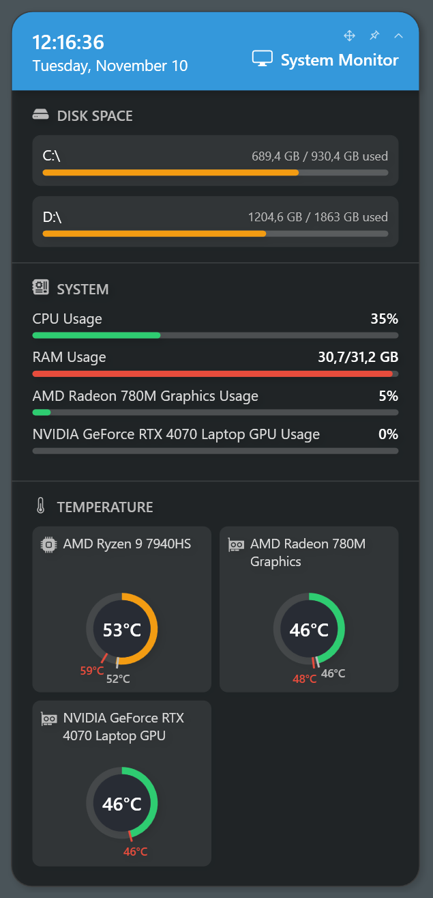

# System Monitor

**English** · [Русский](SystemMonitor.ru.md) · [Back to README](../README.md)

The System Monitor card shows the load of the processor and of each video card, memory use, used space of the disks and the temperatures of the processor and the video cards with their minimum and maximum since the card started. It reads everything once a second and needs no administrator rights.

## Where the values come from

The widget has two sources: **Windows**, which always works, and an optional **sensor program** running next to it. Windows does not report the processor temperature to a regular program, so that value comes only from a sensor program.

| Value | Source |
|---|---|
| CPU temperature | Only the sensor program |
| CPU load | The sensor program, if it reports it; otherwise Windows |
| Video cards: load and temperature | All cards from the sensor program, if it reports at least one; otherwise all from Windows. The cards of the two sources are not mixed |
| Memory | Always Windows |
| Disks | Always Windows |

The program is chosen on the settings screen under **Sensor program**:

| Choice | What it does |
|---|---|
| **Automatic** (default) | The first program found running, in this order: HWiNFO, MSI Afterburner, LibreHardwareMonitor |
| **None, Windows only** | No program; the CPU temperature shows a dash |
| **HWiNFO**, **MSI Afterburner**, **LibreHardwareMonitor** | Only this program |

When there is no CPU temperature, the card says why under the ring: which program to start, that Windows alone was chosen, or that the program does not report it. A program that is started or quit while the card is running is picked up or dropped by itself, without restarting the card.

## Windows

Works always, on any hardware, without other programs.

- **CPU load** — the same counter as in Task Manager (`% Processor Utility`).
- **Memory** — used is total minus available.
- **Video cards** — every WDDM adapter except the software one (Microsoft Basic Render), NPUs and virtual displays. The load is the busiest engine of the adapter, as in Task Manager.
- **Video card temperature** — what the driver reports to Windows (WDDM 2.4 and later, Windows 10 1803+). Not every driver does. A sleeping discrete card of a laptop is shown as **Not active**: the widget does not wake it to ask.
- **Disks** — local, external (USB, memory cards, optical) and network. A disk turned off in the settings is not touched at all: a network drive without a connection does not hang the card, a sleeping external disk is not woken.

## HWiNFO

[HWiNFO](https://www.hwinfo.com/) reads almost every sensor of almost every computer, the CPU temperature included.

1. Start HWiNFO (the Sensors window can stay minimized or closed to the tray).
2. In its settings, turn on **Shared Memory Support**.
3. Leave HWiNFO running.

The free version of HWiNFO keeps Shared Memory Support on for 12 hours; after that, turn it on again. If HWiNFO stops updating the readings for more than 30 seconds, the widget treats it as not running.

What is taken:

- CPU temperature — the first found of `CPU (Tctl/Tdie)`, `CPU Package`, `CPU (Tctl)`, `CPU (Tdie)`, `CPU Die (average)`, `CPU`, `Core Max`.
- CPU load — `Total CPU Utility`, otherwise `Total CPU Usage`.
- Video cards — every `GPU [#n]` sensor: temperature `GPU Temperature`; load `GPU Core Load` (NVIDIA), `GPU Utilization` (AMD) or `GPU D3D Usage` (Intel).

## MSI Afterburner

[MSI Afterburner](https://www.msi.com/Landing/afterburner) shares the graphs that are turned on in its monitoring settings.

1. Start MSI Afterburner.
2. Open **Settings → Monitoring** and turn on the graphs: **GPU temperature**, **GPU usage**, **CPU temperature** and **CPU usage** (the total one).
3. Leave Afterburner running.

Afterburner sees integrated graphics too, but it does not report the CPU temperature on every computer (for example, not on AMD Ryzen 9 7940HS). If the card shows "The sensor program does not report it", use HWiNFO or LibreHardwareMonitor.

A sleeping discrete card of a laptop is reported by Afterburner as 0 °C; the widget shows such a card as **Not active**.

## LibreHardwareMonitor

[LibreHardwareMonitor](https://github.com/LibreHardwareMonitor/LibreHardwareMonitor) is free and open source. It has no shared memory, and its WMI classes do not answer a program without administrator rights, so the widget reads its built-in web server.

1. Start LibreHardwareMonitor (as administrator, so that it sees the CPU temperature).
2. Turn on **Options → Remote Web Server → Run**.
3. If you changed the port or turned on HTTP authentication there, enter the same address, user name and password on the widget's settings screen. The default address is `http://localhost:8085`.

Notes:

- A change of the port or of the interface in LibreHardwareMonitor takes effect only after the server is restarted (turn **Run** off and on).
- If the server listens only on the address of one network interface, the default `localhost` address still works while the port is the default one: the widget finds the address the server listens on.
- The web server is open to the local network. Turn on authentication if the network is not only yours. The password is stored encrypted for the current Windows user (DPAPI).

What is taken:

- CPU temperature — the first found of `Core (Tctl/Tdie)`, `CPU Package`, `Core (Tctl)`, `Core (Tdie)`, `Core Average`, `Core Max`; CPU load — `CPU Total`.
- Video cards (`/gpu-nvidia`, `/gpu-amd`, `/gpu-intel`) — load `GPU Core`, otherwise `D3D 3D`; temperature `GPU Core`, if the card has it.

LibreHardwareMonitor does not tell when a discrete laptop card sleeps, so with it the card always shows a temperature, never **Not active**.

## AIDA64 is not supported

AIDA64 was tried and dropped: on some laptops it does not report the load of the integrated graphics, and because all video cards are taken from one source, that load would disappear from the card. Its trial version also hides the temperatures of video cards.

## Settings

- **Style** — Classic (tiles, rings and bars under a coloured header), CLI report, htop, Prompt, btop, Board and ImHex. The card restarts to take another style.
- **Sections of the card** — Disks, System (CPU, memory and video card load), Temperature. A section turned off is not read either: without System and Temperature the widget does not even look for a sensor program.
- **Disks** — network drives and external drives on or off as a whole, and every drive one by one. A new drive appears on the card at once; an external drive stays turned off whatever letter it gets.
- **Sensor program** — see above.
- **Buttons on the card** — the corner of the buttons Move, Above all windows and Collapse; by default, the corner the card's position is counted from.
- **Collapsed card** — which values the collapsed one-line card shows: CPU load, memory, GPU load, CPU and GPU temperature, disks.
- **Background opacity** — the background of the card in every style; text and bars stay opaque.

## Styles

<!-- SCREENSHOTS of the styles, English and Russian:
     Images/en/system-monitor-classic.png  Images/ru/system-monitor-classic.png
     Images/en/system-monitor-report.png   Images/ru/system-monitor-report.png
     Images/en/system-monitor-htop.png     Images/ru/system-monitor-htop.png
     Images/en/system-monitor-prompt.png   Images/ru/system-monitor-prompt.png
     Images/en/system-monitor-btop.png     Images/ru/system-monitor-btop.png
     Images/en/system-monitor-board.png    Images/ru/system-monitor-board.png
     Images/en/system-monitor-imhex.png    Images/ru/system-monitor-imhex.png

| Classic | CLI report | htop |
|---|---|---|
|  |  |  |

| Prompt | btop | Board |
|---|---|---|
|  |  |  |

| ImHex |
|---|
|  |
-->

| Style | Look |
|---|---|
| Classic | Tiles, rings and bars under a coloured header |
| CLI report | A tree of rows between two lines, dotted bars and status badges, like a command line tool |
| htop | Meters in brackets with the value over the bar; the most compact |
| Prompt | A command line for a header, section icons and smooth bars of blocks |
| btop | Sections in frames, gradient bars and the recent load and temperature as sparklines |
| Board | A table like a departure board: the load and temperature of a device in one row |
| ImHex | The widgets of Dear ImGui, as in ImHex: a window tab, collapsing headers, tables, progress bars and a plot of the load |

## Troubleshooting

| What you see | What to do |
|---|---|
| "Start HWiNFO, Afterburner or LibreHardwareMonitor to see it" (or "Start HWiNFO with shared memory…", "Start the LibreHardwareMonitor web server…") | No sensor program is running, or HWiNFO runs without Shared Memory Support, or the LibreHardwareMonitor web server is off |
| "The sensor program does not report it" | The program runs, but gives no CPU temperature: in Afterburner, turn on the CPU temperature graph, or use another program |
| "Windows does not report it: choose a sensor program in the settings" | **None, Windows only** is chosen |
| HWiNFO worked and stopped | The 12 hours of shared memory in the free version are over: turn Shared Memory Support on again |
| A video card is **Not active** | The discrete card of a laptop sleeps; it wakes when a program needs it |
| A video card has no temperature | Its driver does not report one; a sensor program may |

What the widget found and why a source failed is written to the log of the copy: **Log** in the manager window.
