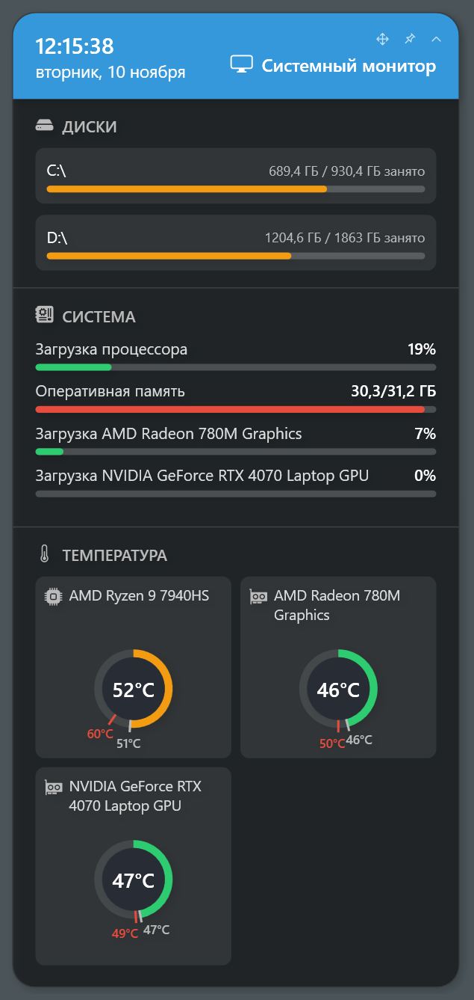

# Системный монитор

[English](SystemMonitor.md) · **Русский** · [К README](../README.ru.md)

Карточка «Системный монитор» показывает загрузку процессора и каждой видеокарты, занятую память, занятое место на дисках и температуры процессора и видеокарт с минимумом и максимумом со старта карточки. Всё читается раз в секунду, прав администратора не нужно.

## Откуда берутся значения

У виджета два источника: **Windows**, который работает всегда, и по желанию **программа датчиков**, запущенная рядом. Температуру процессора Windows обычной программе не сообщает, поэтому её даёт только программа датчиков.

| Значение | Источник |
|---|---|
| Температура процессора | Только программа датчиков |
| Загрузка процессора | Программа датчиков, если она её даёт; иначе Windows |
| Видеокарты: загрузка и температура | Все карты — от программы, если она сообщает хотя бы одну; иначе все от Windows. Карты двух источников не смешиваются |
| Память | Всегда Windows |
| Диски | Всегда Windows |

Программа выбирается на экране настроек в поле **Программа датчиков**:

| Выбор | Что делает |
|---|---|
| **Автоматически** (по умолчанию) | Первая запущенная программа в порядке: HWiNFO, MSI Afterburner, LibreHardwareMonitor |
| **Нет, только Windows** | Без программы; вместо температуры процессора прочерк |
| **HWiNFO**, **MSI Afterburner**, **LibreHardwareMonitor** | Только эта программа |

Когда температуры процессора нет, карточка пишет под кольцом почему: какую программу запустить, что выбран только Windows или что программа её не сообщает. Программу, запущенную или закрытую, пока карточка работает, виджет подхватывает и отпускает сам, без перезапуска карточки.

## Windows

Работает всегда, на любом железе, без других программ.

- **Загрузка процессора** — тот же счётчик, что в Диспетчере задач (`% Processor Utility`).
- **Память** — занято: всего минус доступно.
- **Видеокарты** — все адаптеры WDDM, кроме программного (Microsoft Basic Render), NPU и виртуальных мониторов. Загрузка — самый загруженный блок адаптера, как в Диспетчере задач.
- **Температура видеокарты** — то, что драйвер сообщает Windows (WDDM 2.4 и новее, Windows 10 1803+). Сообщает не каждый драйвер. Спящая дискретная карта ноутбука показывается как **Не активна**: виджет не будит её ради вопроса.
- **Диски** — локальные, внешние (USB, карты памяти, оптические) и сетевые. Выключенный в настройках диск не трогается вовсе: сетевой диск без связи не подвешивает карточку, уснувший внешний не просыпается.

## HWiNFO

[HWiNFO](https://www.hwinfo.com/) читает почти все датчики почти любого компьютера, включая температуру процессора.

1. Запустите HWiNFO (окно Sensors можно свернуть или убрать в трей).
2. В его настройках включите **Shared Memory Support**.
3. Оставьте HWiNFO запущенным.

Бесплатная версия HWiNFO держит Shared Memory Support включённым 12 часов, потом его нужно включить снова. Если HWiNFO не обновляет показания дольше 30 секунд, виджет считает, что программа не запущена.

Что берётся:

- Температура процессора — первое найденное из `CPU (Tctl/Tdie)`, `CPU Package`, `CPU (Tctl)`, `CPU (Tdie)`, `CPU Die (average)`, `CPU`, `Core Max`.
- Загрузка процессора — `Total CPU Utility`, иначе `Total CPU Usage`.
- Видеокарты — каждый датчик `GPU [#n]`: температура `GPU Temperature`; загрузка `GPU Core Load` (NVIDIA), `GPU Utilization` (AMD) или `GPU D3D Usage` (Intel).

## MSI Afterburner

[MSI Afterburner](https://www.msi.com/Landing/afterburner) отдаёт графики, включённые в его настройках мониторинга.

1. Запустите MSI Afterburner.
2. Откройте **Настройки → Мониторинг** и включите графики: **температура ГП**, **загрузка ГП**, **температура ЦП** и **загрузка ЦП** (общая).
3. Оставьте Afterburner запущенным.

Afterburner видит и встроенную графику, но температуру процессора сообщает не на каждом компьютере (например, не на AMD Ryzen 9 7940HS). Если карточка пишет «Программа датчиков её не сообщает», возьмите HWiNFO или LibreHardwareMonitor.

Спящей дискретной карте ноутбука Afterburner пишет 0 °C; такую карту виджет показывает как **Не активна**.

## LibreHardwareMonitor

[LibreHardwareMonitor](https://github.com/LibreHardwareMonitor/LibreHardwareMonitor) — бесплатная программа с открытым кодом. Общей памяти у неё нет, а её классы WMI программе без прав администратора не отвечают, поэтому виджет читает её встроенный веб-сервер.

1. Запустите LibreHardwareMonitor (от имени администратора, чтобы он видел температуру процессора).
2. Включите **Options → Remote Web Server → Run**.
3. Если там изменён порт или включена аутентификация HTTP, введите те же адрес, имя пользователя и пароль на экране настроек виджета. Адрес по умолчанию — `http://localhost:8085`.

Заметки:

- Смена порта или интерфейса в LibreHardwareMonitor действует только после перезапуска сервера (выключить и включить **Run**).
- Если сервер слушает только адрес одного сетевого интерфейса, адрес `localhost` по умолчанию всё равно работает, пока порт стандартный: виджет сам находит адрес, на котором слушает сервер.
- Веб-сервер открыт для локальной сети. Включите аутентификацию, если сеть не только ваша. Пароль хранится зашифрованным для текущего пользователя Windows (DPAPI).

Что берётся:

- Температура процессора — первое найденное из `Core (Tctl/Tdie)`, `CPU Package`, `Core (Tctl)`, `Core (Tdie)`, `Core Average`, `Core Max`; загрузка процессора — `CPU Total`.
- Видеокарты (`/gpu-nvidia`, `/gpu-amd`, `/gpu-intel`) — загрузка `GPU Core`, иначе `D3D 3D`; температура `GPU Core`, если у карты он есть.

LibreHardwareMonitor не сообщает, что дискретная карта ноутбука спит, поэтому с ним у карты всегда есть температура и **Не активна** не бывает.

## AIDA64 не поддерживается

AIDA64 пробовали и убрали: на некоторых ноутбуках она не даёт загрузку встроенной графики, а раз все видеокарты берутся из одного источника, эта загрузка пропала бы с карточки. Пробная версия к тому же скрывает температуры видеокарт.

## Настройки

- **Стиль** — классический (плитки, кольца и полосы под цветной шапкой), CLI-отчёт, htop, промпт, btop, табло и ImHex. Чтобы взять другой стиль, карточка перезапускается.
- **Блоки карточки** — диски, система (загрузка процессора, памяти и видеокарт), температура. Выключенный блок и не читается: без системы и температуры виджет даже не ищет программу датчиков.
- **Диски** — сетевые и внешние диски целиком, и каждый диск по отдельности. Новый диск появляется на карточке сразу; выключенный внешний диск остаётся выключенным под любой буквой.
- **Программа датчиков** — см. выше.
- **Кнопки на карточке** — угол кнопок «Переместить», «Поверх всех окон» и «Свернуть»; по умолчанию — угол, от которого отсчитывается положение карточки.
- **Свёрнутая карточка** — какие значения показывает свёрнутая в строку карточка: загрузка процессора, память, загрузка видеокарт, температура процессора и видеокарт, диски.
- **Непрозрачность фона** — фон карточки во всех стилях; текст и полосы остаются непрозрачными.

## Стили

<!-- СКРИНШОТЫ стилей, английские и русские:
     Images/en/system-monitor-classic.png  Images/ru/system-monitor-classic.png
     Images/en/system-monitor-report.png   Images/ru/system-monitor-report.png
     Images/en/system-monitor-htop.png     Images/ru/system-monitor-htop.png
     Images/en/system-monitor-prompt.png   Images/ru/system-monitor-prompt.png
     Images/en/system-monitor-btop.png     Images/ru/system-monitor-btop.png
     Images/en/system-monitor-board.png    Images/ru/system-monitor-board.png
     Images/en/system-monitor-imhex.png    Images/ru/system-monitor-imhex.png

| Классический | CLI-отчёт | htop |
|---|---|---|
|  |  |  |

| Промпт | btop | Табло |
|---|---|---|
|  |  |  |

| ImHex |
|---|
|  |
-->

| Стиль | Вид |
|---|---|
| Классический | Плитки, кольца и полосы под цветной шапкой |
| CLI-отчёт | Дерево строк между двумя линиями, точечные полосы и плашки состояния, как у утилиты командной строки |
| htop | Шкалы в скобках со значением поверх полосы; самый компактный |
| Промпт | Командная строка вместо шапки, значки разделов и плавные полосы из блоков |
| btop | Разделы в рамках, градиентные полосы и недавние загрузка и температура спарклайнами |
| Табло | Таблица как табло вылетов: загрузка и температура устройства в одной строке |
| ImHex | Элементы Dear ImGui, как в ImHex: вкладка окна, сворачиваемые заголовки, таблицы, полосы прогресса и график загрузки |

## Если что-то не так

| Что видно | Что делать |
|---|---|
| «Запустите HWiNFO, Afterburner или LibreHardwareMonitor» (или «Запустите HWiNFO с общей памятью», «Запустите веб-сервер LibreHardwareMonitor») | Программа датчиков не запущена, или HWiNFO работает без Shared Memory Support, или выключен веб-сервер LibreHardwareMonitor |
| «Программа датчиков её не сообщает» | Программа работает, но температуры процессора не даёт: в Afterburner включите график температуры ЦП или возьмите другую программу |
| «Windows её не сообщает: выберите программу датчиков в настройках» | Выбрано **Нет, только Windows** |
| HWiNFO работал и перестал | Кончились 12 часов общей памяти бесплатной версии: включите Shared Memory Support снова |
| Видеокарта **Не активна** | Дискретная карта ноутбука спит; она проснётся, когда понадобится программе |
| У видеокарты нет температуры | Её драйвер температуру не сообщает; программа датчиков может |

Что виджет нашёл и почему источник не ответил, записывается в журнал копии: **Журнал** в окне менеджера.
