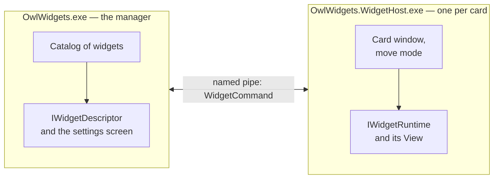

# Creating widgets

**English** · [Русский](WidgetDevelopment.ru.md) · [Back to README](../README.md)

This guide is for developers who want to write their own widget for Owl Widgets. A widget is a WPF library on .NET 8 that implements two interfaces from `OwlWidgets.Contracts`. The program finds it in its `Widgets` folder, without any change to the program itself.

> The program is in version 0.x. The contracts are kept compatible, but until 1.0.0 small changes are possible; check the release notes when you update.

## How it works



- **The manager** (`OwlWidgets.exe`) is one process. It finds the widgets, keeps the list of their copies (instances), stores their settings and logs, and shows the settings screens. It loads only the **descriptor** of a widget: a light assembly with its name, icon and settings screen.
- **The host** (`OwlWidgets.WidgetHost.exe`) is a separate process for every running card. It creates the transparent window, the move mode and the channel to the manager, and loads the **runtime** of the widget: the assembly with the card itself.
- **The widget** creates no windows and knows nothing about the channel or the z-order. Its runtime gives a WPF element; the host puts it on the desktop.

So a crash of a card ends only its own process: the manager and the other cards keep working. But the descriptor lives in the manager's process for the whole session, so it must stay light and safe: no polling, no timers, no native libraries, no heavy dependencies.

Between the settings screen (in the manager) and the card (in the host) only the JSON of the settings travels.

## Quick start

A widget "Hello" that shows a greeting from its settings and the current time. It is built outside the Owl Widgets source tree, against the DLLs of an installed copy of the program.

You need the [.NET 8 SDK](https://dotnet.microsoft.com/download/dotnet/8.0) and an unpacked [release](https://github.com/snowy-owll/OwlWidgets/releases/latest) of Owl Widgets; below it is in `D:\Programs\OwlWidgets`.

```text
HelloWidget.Descriptor/
  HelloWidget.Descriptor.csproj
  Descriptor.cs
  Config.cs
  SettingsEditor.cs
HelloWidget/
  HelloWidget.csproj
  Runtime.cs
  Content.xaml
  Content.xaml.cs
  ContentViewModel.cs
```

### The descriptor project

`HelloWidget.Descriptor/HelloWidget.Descriptor.csproj`:

```xml
<Project Sdk="Microsoft.NET.Sdk">

  <PropertyGroup>
    <TargetFramework>net8.0-windows</TargetFramework>
    <UseWPF>true</UseWPF>
    <Nullable>enable</Nullable>
    <ImplicitUsings>enable</ImplicitUsings>
    <RootNamespace>HelloWidget</RootNamespace>
    <!-- The folder of the installed Owl Widgets. -->
    <OwlWidgetsDir Condition="'$(OwlWidgetsDir)' == ''">D:\Programs\OwlWidgets</OwlWidgetsDir>
  </PropertyGroup>

  <ItemGroup>
    <!-- Given by the manager and the host: compile against it, do not copy it. -->
    <Reference Include="OwlWidgets.Contracts" HintPath="$(OwlWidgetsDir)\OwlWidgets.Contracts.dll" Private="false" />
  </ItemGroup>

</Project>
```

`Descriptor.cs`:

```csharp
using OwlWidgets.Contracts;

namespace HelloWidget;

public sealed class Descriptor : IWidgetDescriptor
{
    // Generate your own Guid once and never change it: the copies of the widget are bound to it.
    public Guid Id { get; } = Guid.Parse("0f8a3c2e-5b7d-4e41-9a6c-2d1e8b4f7a90");

    public string Name => "Hello";

    public string Description => "A greeting and the current time.";

    public string Version => "0.1.0";

    public string Author => "Your Name";

    public bool AllowMultipleInstances => true;

    // The settings screen of one copy; null if the widget has none.
    public IWidgetSettingsEditor? CreateSettingsEditor(string? settings, WidgetInstanceInfo instance) =>
        new SettingsEditor(settings);
}
```

`Config.cs` — the settings of one copy. It lives in the descriptor, so that both the settings screen and the runtime can use it:

```csharp
namespace HelloWidget;

public sealed class Config
{
    public string Greeting { get; set; } = "Hello!";
}
```

`SettingsEditor.cs` — the settings screen, shown inside the manager window. It can be XAML as well; here it is built in code to stay short.

```csharp
using System.Text.Json;
using System.Windows;
using System.Windows.Controls;
using OwlWidgets.Contracts;

namespace HelloWidget;

internal sealed class SettingsEditor : IWidgetSettingsEditor
{
    private readonly TextBox _greeting = new() { MinWidth = 260, HorizontalAlignment = HorizontalAlignment.Left };
    private readonly StackPanel _view = new();
    private string _accepted = string.Empty;

    public SettingsEditor(string? settings)
    {
        _view.Children.Add(new TextBlock { Text = "Greeting", Margin = new Thickness(0, 0, 0, 4) });
        _view.Children.Add(_greeting);
        _greeting.TextChanged += (_, _) => HasChangesChanged?.Invoke(this, EventArgs.Empty);
        ReplaceSettings(settings);
    }

    public FrameworkElement View => _view;

    public bool HasChanges => Serialize() != _accepted;

    public event EventHandler? HasChangesChanged;

    public bool TrySerialize(out string settings)
    {
        settings = Serialize();
        return true;
    }

    public void Accept()
    {
        _accepted = Serialize();
        HasChangesChanged?.Invoke(this, EventArgs.Empty);
    }

    public void ReplaceSettings(string? settings)
    {
        Config config;
        try
        {
            config = string.IsNullOrWhiteSpace(settings) ? new Config() : JsonSerializer.Deserialize<Config>(settings) ?? new Config();
        }
        catch (JsonException)
        {
            config = new Config();
        }

        _greeting.Text = config.Greeting;
        _accepted = Serialize();
        HasChangesChanged?.Invoke(this, EventArgs.Empty);
    }

    public void Dispose()
    {
    }

    private string Serialize() => JsonSerializer.Serialize(new Config { Greeting = _greeting.Text });
}
```

### The runtime project

`HelloWidget/HelloWidget.csproj`:

```xml
<Project Sdk="Microsoft.NET.Sdk">

  <PropertyGroup>
    <TargetFramework>net8.0-windows</TargetFramework>
    <UseWPF>true</UseWPF>
    <Nullable>enable</Nullable>
    <ImplicitUsings>enable</ImplicitUsings>
    <OwlWidgetsDir Condition="'$(OwlWidgetsDir)' == ''">D:\Programs\OwlWidgets</OwlWidgetsDir>
  </PropertyGroup>

  <ItemGroup>
    <Reference Include="OwlWidgets.Contracts" HintPath="$(OwlWidgetsDir)\OwlWidgets.Contracts.dll" Private="false" />
    <Reference Include="OwlWidgets.Common" HintPath="$(OwlWidgetsDir)\OwlWidgets.Common.dll" Private="false" />
    <Reference Include="OwlWidgets.UI.Common" HintPath="$(OwlWidgetsDir)\OwlWidgets.UI.Common.dll" Private="false" />
    <ProjectReference Include="..\HelloWidget.Descriptor\HelloWidget.Descriptor.csproj" />
  </ItemGroup>

</Project>
```

`ContentViewModel.cs`:

```csharp
using OwlWidgets.Common;

namespace HelloWidget;

public sealed class ContentViewModel : ViewModelBase
{
    public string? Greeting
    {
        get => GetValue(() => Greeting);
        set => SetValue(() => Greeting, value);
    }

    public DateTime Time
    {
        get => GetValue(() => Time);
        set => SetValue(() => Time, value);
    }
}
```

`Content.xaml` — the card. `CardStyle` from `OwlWidgets.UI.Common` gives the frame shared by all cards: the translucent background, the border, the corners and the shadow.

```xml
<UserControl
    x:Class="HelloWidget.Content"
    xmlns="http://schemas.microsoft.com/winfx/2006/xaml/presentation"
    xmlns:x="http://schemas.microsoft.com/winfx/2006/xaml">
    <UserControl.Resources>
        <ResourceDictionary>
            <ResourceDictionary.MergedDictionaries>
                <ResourceDictionary Source="/OwlWidgets.UI.Common;component/Themes/Card.xaml" />
            </ResourceDictionary.MergedDictionaries>
        </ResourceDictionary>
    </UserControl.Resources>

    <Border Width="240" Padding="16" Style="{StaticResource CardStyle}">
        <StackPanel>
            <TextBlock FontSize="18" Foreground="White" Text="{Binding Greeting}" />
            <TextBlock Margin="0,4,0,0" FontSize="32" Foreground="White" Text="{Binding Time, StringFormat=T}" />
        </StackPanel>
    </Border>
</UserControl>
```

`Content.xaml.cs`:

```csharp
namespace HelloWidget;

public partial class Content
{
    public Content() => InitializeComponent();
}
```

`Runtime.cs`:

```csharp
using System.Text.Json;
using System.Windows;
using System.Windows.Threading;
using OwlWidgets.Contracts;

namespace HelloWidget;

public sealed class Runtime : IWidgetRuntime
{
    private readonly ContentViewModel _model = new();
    private readonly DispatcherTimer _timer = new() { Interval = TimeSpan.FromSeconds(1) };
    private IWidgetHostContext? _context;

    public FrameworkElement? View { get; private set; }

    public void Start(IWidgetHostContext context)
    {
        _context = context;

        Config config;
        try
        {
            config = Parse(context.Settings);
        }
        catch (Exception exception)
        {
            context.Logger.Log(WidgetLogLevel.Error, "Settings were not read, defaults are used.", exception);
            config = new Config();
        }

        _model.Greeting = config.Greeting;
        _model.Time = DateTime.Now;
        _timer.Tick += OnTick;
        _timer.Start();
        View = new Content { DataContext = _model };
    }

    public void Receive(WidgetCommand command)
    {
        switch (command.Code)
        {
            case WidgetCommandCodes.ApplySettings:
                try
                {
                    _model.Greeting = Parse(WidgetCommandJson.ReadUtf8(command.Body)).Greeting;
                }
                catch (Exception exception)
                {
                    // Broken JSON keeps the card as it was.
                    _context?.Logger.Log(WidgetLogLevel.Error, "Settings were not applied.", exception);
                }
                break;

            case WidgetCommandCodes.Theme:
                var dark = WidgetCommandJson.Deserialize<ThemeBody>(command.Body)?.Dark == true;
                // Switch the colours of the card here.
                break;

            // Other codes are ignored: newer versions of the program may send more.
        }
    }

    public void Stop()
    {
        _timer.Stop();
        _timer.Tick -= OnTick;
        View = null;
    }

    public void Dispose() => Stop();

    private void OnTick(object? sender, EventArgs e) => _model.Time = DateTime.Now;

    private static Config Parse(string? settings) =>
        string.IsNullOrWhiteSpace(settings) ? new Config() : JsonSerializer.Deserialize<Config>(settings) ?? new Config();
}
```

### Build and install

1. Quit Owl Widgets (**Exit** in the tray menu): while the manager runs, the descriptor DLLs are locked.
2. Publish the runtime project straight into a new folder under `Widgets`:

   ```bash
   dotnet publish HelloWidget/HelloWidget.csproj -c Release -o "D:\Programs\OwlWidgets\Widgets\Hello"
   ```

   The folder gets `HelloWidget.dll`, `HelloWidget.Descriptor.dll`, `HelloWidget.deps.json` and the dependencies, if there are any. The `OwlWidgets.*` assemblies are not copied: `Private="false"`.
3. Start `OwlWidgets.exe`. **Hello** appears in **Add widget** and in **About → Installed widgets**.
4. Add it. The card appears on the desktop. Change the greeting on the **Widget** page of the copy and save: the running card receives `apply-settings` and shows it at once. The **JSON** page shows what was written.

If the widget does not appear, open **Log** in the manager: the catalog writes why a folder was skipped or a package rejected.

### Debugging

- The card runs in its own `OwlWidgets.WidgetHost.exe`. Attach the debugger to that process (Visual Studio: **Debug → Attach to Process**), or put `System.Diagnostics.Debugger.Launch();` at the start of `Start` for a while.
- The settings screen and the descriptor run in `OwlWidgets.exe`.
- What the widget writes to `IWidgetLogger` is shown on the **Log** screen and saved to `Data/logs/{instanceId}/`. A Release build of the program writes from `Information` up; `Debug` and `Trace` reach the files only in a Debug build of the program.

## The widget package

A package is one folder: `Widgets/{any name}/`. The folder name does not matter: the type is identified by `IWidgetDescriptor.Id`.

The manager looks only at the DLLs right in the folder, not in subfolders, and reads their metadata without running their code:

| What is found | Result |
|---|---|
| Exactly one public non-abstract class with a public parameterless constructor for `IWidgetDescriptor` and exactly one for `IWidgetRuntime` | A widget |
| Only one of the two interfaces | Rejected |
| More than one implementation of either interface | Rejected |
| Neither interface | Skipped: not a widget |
| The same `Id` in two folders | Both rejected |

Subfolders are for dependencies: translations (`ru/`), native files (`runtimes/`), `Assets/`.

Both classes may be in one DLL, but two DLLs are much better: the manager loads only the descriptor's DLL and everything it references. With one DLL, the whole card's code and its dependencies end up in the manager.

**Do not ship** your own copies of `OwlWidgets.Contracts`, `OwlWidgets.Common`, `OwlWidgets.UI.Common`, `OwlWidgets.Protocol`, `MaterialDesignThemes.Wpf`, `MaterialDesignColors` and `Microsoft.Xaml.Behaviors`. The program always uses its own; a copy in the widget folder is ignored.

**Contracts version.** A widget built against a newer `OwlWidgets.Contracts` than the one of the installed program is marked incompatible and is not started. Build against the oldest version of the program you want to support.

## The descriptor: `IWidgetDescriptor`

| Member | Meaning |
|---|---|
| `Guid Id` | The type of the widget. Choose once, never change: the copies, their settings and logs are bound to it |
| `string Name`, `Description`, `Version`, `Author` | Shown in the manager. `Name` and `Description` may come from resources, see [Languages](#languages) |
| `bool AllowMultipleInstances` | `false` — the manager does not let the user add a second copy |
| `ImageSource? Icon` | The icon of the type; `null` by default. Read once and frozen |
| `HostThemeInheritance HostTheme` | Whether the card takes the Material Design look of the program: `Off` (default), `On`, `Required` |
| `Task<string?> CreateStarterSettingsAsync(...)` | Settings of a copy the manager creates by itself on the first start; `null` by default. Now it is used only for Weather |
| `IWidgetSettingsEditor? CreateSettingsEditor(string? settings, WidgetInstanceInfo instance)` | The settings screen of one copy, or `null` if there is none |

The constructor of the descriptor and `CreateSettingsEditor` must not start polling, timers or native sessions: that is the work of `IWidgetRuntime.Start`. An exception in the constructor or in a property makes the package unusable (it is written to the log); an exception in a static constructor or in an event handler of the settings screen can bring down the manager.

**Icon.** A PNG with a transparent background, 128 px or more, embedded in the descriptor assembly as `Resource` and opened by a pack URI. The manager fits it into a square of 28 or 40 px.

```xml
<ItemGroup>
  <Resource Include="Assets\Icon.png" />
</ItemGroup>
```

```csharp
public ImageSource? Icon =>
    new BitmapImage(new Uri("pack://application:,,,/HelloWidget.Descriptor;component/Assets/Icon.png"));
```

A file from the widget folder does not suit the icon: the manager's current folder is its own.

### The settings screen: `IWidgetSettingsEditor`

The manager shows the screen on the **Widget** page of a copy and in the **Add widget** dialog. The editor is created for one copy with its current JSON (`null` or empty — defaults).

| Member | Meaning |
|---|---|
| `FrameworkElement View` | The screen. It is placed inside the manager window and gets its Material Design theme |
| `bool HasChanges`, `event HasChangesChanged` | Whether the screen differs from the last accepted settings; turns the **Save settings** button on |
| `bool TrySerialize(out string settings)` | The JSON of the screen. `false` — the input is incomplete; the screen shows the error itself, nothing is written |
| `void Accept()` | The manager has written the file; take the screen as the new saved state and reset `HasChanges` |
| `void ReplaceSettings(string? settings)` | Show this JSON instead (written by the card itself or restored by **Discard changes**); unsaved edits are lost |
| `bool RequiresRestart` | `true` — the change takes effect only on start (another layout, for example); the manager restarts the copy instead of sending `apply-settings`. `false` by default |
| `Dispose()` | The screen is closed. Delete files you put into `InstanceDataFolder` and that were not saved |

`TrySerialize` does not fix the snapshot; only `Accept` does. Every call from the manager into the editor is guarded: an exception is logged and treated as "nothing happened".

The settings screen runs on the manager's UI thread. A list it needs to fill (devices, adapters) is read on demand in the thread pool, and its failure is shown as text on the screen.

## The card: `IWidgetRuntime`

```csharp
public interface IWidgetRuntime : IDisposable
{
    FrameworkElement? View { get; }      // the root of the card after Start and until Stop
    void Start(IWidgetHostContext context);
    void Receive(WidgetCommand command); // a command for the widget; unknown codes are ignored
    void Stop();
}
```

- `Start`, `Receive`, `Stop`, `Dispose` and reading `View` are called on the UI thread of the host (WPF, STA). Update the visual tree from other threads through `Dispatcher`.
- `Start` must return quickly. Do the slow work (network, devices) asynchronously after it. Watch `context.Stopping`: it is cancelled when the copy is being stopped, even while `Start` is still running.
- After `Stop` and `Dispose` the process ends; release timers and handles there anyway. The whole shutdown has 3 seconds: a process that has not exited by then is ended by the manager.
- An exception from `Receive` is logged and does not end the process. An unhandled exception anywhere else ends the card's process; the manager may restart it if **Restart after a crash** is on.

### The host context: `IWidgetHostContext`

| Member | Meaning |
|---|---|
| `WidgetId`, `InstanceId` | The type and this copy |
| `ContentRoot` | The absolute path of the widget folder. It is also the current directory of the host |
| `InstanceDataFolder` | The folder of this copy's files, `Data/storage/{instanceId}`. Lives between starts and is deleted with the copy. It may not exist yet: create it when you write |
| `Settings` | The JSON of this copy at the moment of `Start`; `null` or empty — defaults. Do not read the settings file yourself |
| `Stopping` | Cancelled when the copy is being stopped |
| `Logger` | `IWidgetLogger`: the log of this copy |
| `Send(WidgetCommand)` | A command to the manager or to the host. Can be called from any thread |

## Settings

Settings are plain JSON chosen by the widget, one file per copy (`Data/settings/{instanceId}.json`). Only the manager writes it. The position, the corner, "above all windows" and the start policies are not in it: the manager keeps them in its own registry of copies.

- An empty string or `null` means defaults. Unknown or missing fields should also fall back to defaults.
- A parse error in `Start` — log it and start with defaults.
- A parse error on `apply-settings` — log it and keep the previous state.
- Saving on the settings screen sends `apply-settings` with the new JSON to a running card (or restarts it if `RequiresRestart` is `true`). A stopped card gets the new JSON on the next start.
- The card can save settings by itself (for example, a value the user changed right on the card): send `persist-settings` with the full new JSON to the manager. The manager writes the file and does not send `apply-settings` back.

```csharp
context.Send(new WidgetCommand(
    WidgetCommandCodes.PersistSettings,
    WidgetCommandTarget.Manager,
    System.Text.Encoding.UTF8.GetBytes(JsonSerializer.Serialize(config))));
```

Do not put secrets into the settings as plain text: the JSON is visible on the **JSON** page. A password can be protected with DPAPI for the current user (`System.Security.Cryptography.ProtectedData`), as System Monitor does.

## Commands

The widget talks to the program with `WidgetCommand(Code, Target, Body)`. The code and the target are strings, the body is bytes; the codes of this version carry UTF-8 JSON (camelCase), which `WidgetCommandJson.Serialize`, `Deserialize<T>` and `ReadUtf8` read and write. The constants are in `WidgetCommandCodes` and `WidgetCommandTarget`, the body types in `CommandBodies.cs`.

The memory of a body is valid only during `Receive`; copy it to keep it. A body is at most 256 KB.

### The widget receives

| Code | Body | When |
|---|---|---|
| `apply-settings` | The JSON of the settings | Saved on the settings screen while the card runs |
| `theme` | `ThemeBody { dark }` | The light or dark theme of the copy: right after `Start`, then on every change |
| `language` | `LanguageBody { language }` (`en`, `ru`) | Once, right after `Start` |
| `anchor` | `AnchorBody { anchor }` (`TopLeft`, `TopRight`, `BottomLeft`, `BottomRight`) | The corner the position is counted from: right after `Start`, then on every change. For example, to put the card's buttons in that corner |
| `topmost` | `TopmostBody { topmost }` | Whether the card is above all windows: right after `Start`, then on every change |
| `move-mode` | `MoveModeBody { active, positionSaved }` | The move mode started or ended |
| `stopping` | `user`, `manager-exit` or `self` | The card is about to be stopped; it still may send `persist-settings` and `show-notification` |

### The widget sends

| Code | Target | Body | What it does |
|---|---|---|---|
| `enter-move-mode` | `wrapper` | — | Turns on the move mode, as **Move** in the manager. For a move button on the card |
| `set-topmost` | `manager` | `TopmostBody` | Keep the card above all windows or put it back. The answer comes as `topmost` |
| `persist-settings` | `manager` | The JSON of the settings | Write the settings file of this copy |
| `show-notification` | `manager` | `NotificationBody { title, message }` | A Windows notification from the program |
| `open-settings` | `manager` | — | Opens the manager window on this copy's settings. For a "set me up" button on an empty card |
| `stop` | `manager` | — | Asks to stop this copy |

New features of the program come as new codes, not as new methods, so a widget built for an older version keeps working: just ignore unknown codes.

## Look of the card

- The host window is transparent and sizes itself to the content (`SizeToContent`). Your `View` draws the whole card. Around it the host leaves a transparent margin of 16 px for the shadow, so the card needs no margin for it.
- For the usual look, put `CardStyle` from `/OwlWidgets.UI.Common;component/Themes/Card.xaml` on the root `Border` and set only its width and padding. In the same dictionary: `CardButtonStyle` for buttons on the card and `CardRefreshButtonStyle` for the "Refresh" icon after a failed request.
- A card that has nothing to show without settings can show `SettingsPrompt` from `OwlWidgets.UI.Common` (`Message` — your text, `Command` — sends `open-settings`).
- The card may change its size: the host keeps the chosen corner of the card in place. A card that animates its size should keep the size of its root during the animation and animate an inner element: a transparent window shows the new picture a moment later than its new position, and a corner other than the top left one would shake.
- **Theme.** Without inheritance WPF has no dark theme of its own: the widget gets `theme` and styles itself. With `HostTheme` = `On` or `Required` the host adds Material Design (MaterialDesignThemes 5.x, the version of the program) to the resources of the application, sets the theme's text colour and font on the root, and the user may turn it off (unless `Required`). Use `Required` only if `View` refers to theme resources by key and does not load without them.

## Files and paths

| Way | Where it points |
|---|---|
| A relative path in the runtime (`Assets\data.json`) | The widget folder: it is the current directory of the host |
| `IWidgetHostContext.ContentRoot` | The same folder, absolute |
| `WidgetInstanceInfo.ContentRoot` on the settings screen | The same folder. A relative path in the manager points to the manager's folder |
| `InstanceDataFolder` | The files of the copy: user imports, cache, last result |
| `pack://application:,,,/Assembly;component/...` | A `Resource` inside the assembly, the same in both processes |
| `AppContext.BaseDirectory`, `pack://siteoforigin:` | The folder of the EXE, **not** the widget folder — do not use them for widget files |

Files that appear while the copy works go to `InstanceDataFolder`, never into the widget folder: it may be read-only and is replaced on update.

## Languages

The program speaks English (neutral) and Russian. The language is fixed for the life of a process: the host sets `CultureInfo.CurrentUICulture` before it loads the runtime, so `{x:Static}` strings and resources are already in the right language when `View` is built. The `language` command tells the code as well.

- Keep the strings in `Properties/Strings.resx` (English) and `Strings.ru.resx` of the descriptor project, with a public class (`PublicResXFileCodeGenerator`) — `x:Static` does not reach an internal one. The descriptor needs them for the settings screen, the runtime references the descriptor.
- `Name` and `Description` of the descriptor may return resource strings: the manager reads them in the chosen language.
- Numbers, times and numeric dates follow `CultureInfo.CurrentCulture`, the regional settings of Windows, not the interface language. The host sets `FrameworkElement.Language` for bindings accordingly.
- A date written with words is part of the interface: format it with `CultureInfo.CurrentUICulture`, so that the names of days and months and their order match the language, for example `now.ToString("dddd", CultureInfo.CurrentUICulture)`. Otherwise an English interface on a Russian region would say "вторник, 10 ноября".
- Satellite assemblies (`ru/*.resources.dll`) go into the widget folder with `dotnet publish`.

## Dependencies

- NuGet packages of the runtime are found through its `.deps.json`, as in a normal application; publish puts them next to it. A library referenced from XAML (`xmlns`) is found in the widget folder too.
- Keep the descriptor's dependencies to a minimum: they stay in the manager's process until it exits and cannot be unloaded.
- A native DLL goes into the root of the widget folder (or `runtimes/win-x64/native` via `.deps.json`); the name in `DllImport` must match the file name. Its own native dependencies lie next to it. The host looks in the widget folder first.
- Build framework-dependent, not self-contained: the program runs on the installed .NET 8 Desktop Runtime.
- While a copy runs, its runtime DLLs are locked; while the manager runs, the descriptor DLL is locked.

## Good manners

- No administrator rights. Everything must work as a regular user.
- Network requests: wait between them with `WallClock.DelayAsync` from `OwlWidgets.Common` rather than `Task.Delay` — .NET timers stand still while the computer sleeps, and the update after waking would be late by the whole sleep. After a failed request, keep the last data on the card and offer a refresh (`CardRefreshButtonStyle`).
- Log a failure of a source once until it recovers, not every second.
- Do not keep the CPU busy: a card is on the screen all day. Round values to what is shown, so an unchanged digit does not redraw the card.

## Developing inside this repository

The built-in widgets are built differently: from the solution, with project references instead of DLLs from an installed copy.

1. Two projects: `OwlWidgets.Widgets.{Name}.Descriptor` and `OwlWidgets.Widgets.{Name}`, both `net8.0-windows`, `UseWPF`, `Nullable`, `ImplicitUsings`. Project references to `OwlWidgets.Contracts` (and, if needed, `OwlWidgets.Common`, `OwlWidgets.UI.Common`); the runtime references the descriptor, never the other way.
2. In both projects set `<WidgetFolder>{Name}</WidgetFolder>` and import `..\WidgetPackage.targets`. After the build it copies the widget into `OwlWidgets/bin/{Configuration}/net8.0-windows/Widgets/{Name}` without the shared assemblies.
3. In `OwlWidgets/OwlWidgets.csproj`, add a reference to the runtime project with `ReferenceOutputAssembly=false`: it only orders the build. Add both projects to `OwlWidgets.sln`.
4. A project with NuGet packages needs `<CopyLocalLockFileAssemblies>true</CopyLocalLockFileAssemblies>`.
5. Strings in both `Strings.resx` and `Strings.ru.resx`; icons and pictures only public domain, CC0 or under a permissive license (MIT, Apache 2.0) with its text and a `NOTICE.txt` next to them.

Look at `OwlWidgets.Widgets.NetworkMonitor` as a small and complete example: a settings screen, a card with a view model, resources in two languages and an icon.

## Checklist

- [ ] My own `Id`, generated once.
- [ ] Two DLLs: a light descriptor and the runtime.
- [ ] No `OwlWidgets.*` and Material Design assemblies in the package.
- [ ] Empty or broken settings start the card with defaults; broken `apply-settings` keeps the previous state.
- [ ] `Start` returns quickly and watches `Stopping`; `Stop` releases timers and handles.
- [ ] Unknown commands are ignored.
- [ ] Files of a copy are in `InstanceDataFolder`; files of the widget are read relative to `ContentRoot`.
- [ ] `CardStyle` on the root, no own shadow margin.
- [ ] Works without administrator rights.
