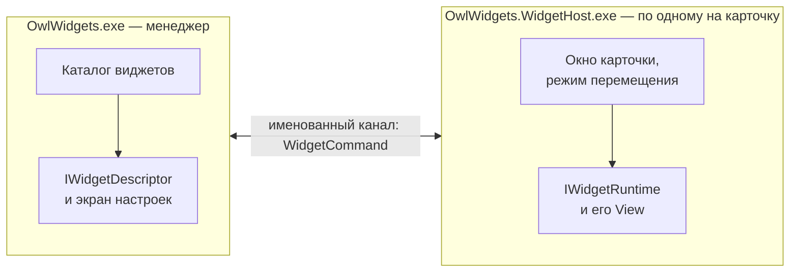

# Создание виджетов

[English](WidgetDevelopment.md) · **Русский** · [К README](../README.ru.md)

Руководство для разработчиков, которые хотят написать свой виджет для Owl Widgets. Виджет — это библиотека WPF на .NET 8, которая реализует два интерфейса из `OwlWidgets.Contracts`. Программа находит его в своей папке `Widgets`, сама программа при этом не меняется.

> Программа в версии 0.x. Контракты держатся совместимыми, но до 1.0.0 возможны небольшие изменения; при обновлении смотрите описание выпуска.

## Как это устроено



- **Менеджер** (`OwlWidgets.exe`) — один процесс. Он находит виджеты, ведёт список их копий (экземпляров), хранит их настройки и журналы и показывает экраны настроек. Из виджета он загружает только **дескриптор** — лёгкую сборку с именем, иконкой и экраном настроек.
- **Обёртка** (`OwlWidgets.WidgetHost.exe`) — отдельный процесс на каждую запущенную карточку. Она создаёт прозрачное окно, режим перемещения и канал с менеджером и загружает **runtime** виджета — сборку с самой карточкой.
- **Виджет** окон не создаёт и ничего не знает о канале и z-порядке. Его runtime отдаёт элемент WPF, обёртка ставит его на рабочий стол.

Поэтому падение карточки завершает только её процесс: менеджер и другие карточки работают дальше. Зато дескриптор живёт в процессе менеджера весь сеанс и должен быть лёгким и безопасным: без опроса, таймеров, нативных библиотек и тяжёлых зависимостей.

Между экраном настроек (в менеджере) и карточкой (в обёртке) ходит только JSON настроек.

## Быстрый старт

Виджет «Hello» показывает приветствие из своих настроек и текущее время. Он собирается вне исходников Owl Widgets, по DLL установленной копии программы.

Нужны [.NET 8 SDK](https://dotnet.microsoft.com/download/dotnet/8.0) и распакованный [выпуск](https://github.com/snowy-owll/OwlWidgets/releases/latest) Owl Widgets; ниже он лежит в `D:\Programs\OwlWidgets`.

```text
HelloWidget.Descriptor/
  HelloWidget.Descriptor.csproj
  Descriptor.cs
  Config.cs
  SettingsEditor.cs
HelloWidget/
  HelloWidget.csproj
  Runtime.cs
  Content.xaml
  Content.xaml.cs
  ContentViewModel.cs
```

### Проект дескриптора

`HelloWidget.Descriptor/HelloWidget.Descriptor.csproj`:

```xml
<Project Sdk="Microsoft.NET.Sdk">

  <PropertyGroup>
    <TargetFramework>net8.0-windows</TargetFramework>
    <UseWPF>true</UseWPF>
    <Nullable>enable</Nullable>
    <ImplicitUsings>enable</ImplicitUsings>
    <RootNamespace>HelloWidget</RootNamespace>
    <!-- The folder of the installed Owl Widgets. -->
    <OwlWidgetsDir Condition="'$(OwlWidgetsDir)' == ''">D:\Programs\OwlWidgets</OwlWidgetsDir>
  </PropertyGroup>

  <ItemGroup>
    <!-- Given by the manager and the host: compile against it, do not copy it. -->
    <Reference Include="OwlWidgets.Contracts" HintPath="$(OwlWidgetsDir)\OwlWidgets.Contracts.dll" Private="false" />
  </ItemGroup>

</Project>
```

`Descriptor.cs`:

```csharp
using OwlWidgets.Contracts;

namespace HelloWidget;

public sealed class Descriptor : IWidgetDescriptor
{
    // Generate your own Guid once and never change it: the copies of the widget are bound to it.
    public Guid Id { get; } = Guid.Parse("0f8a3c2e-5b7d-4e41-9a6c-2d1e8b4f7a90");

    public string Name => "Hello";

    public string Description => "A greeting and the current time.";

    public string Version => "0.1.0";

    public string Author => "Your Name";

    public bool AllowMultipleInstances => true;

    // The settings screen of one copy; null if the widget has none.
    public IWidgetSettingsEditor? CreateSettingsEditor(string? settings, WidgetInstanceInfo instance) =>
        new SettingsEditor(settings);
}
```

`Config.cs` — настройки одной копии. Они лежат в дескрипторе, чтобы ими пользовались и экран настроек, и runtime:

```csharp
namespace HelloWidget;

public sealed class Config
{
    public string Greeting { get; set; } = "Hello!";
}
```

`SettingsEditor.cs` — экран настроек, его показывает окно менеджера. Можно сделать его и в XAML; здесь он собран кодом ради краткости.

```csharp
using System.Text.Json;
using System.Windows;
using System.Windows.Controls;
using OwlWidgets.Contracts;

namespace HelloWidget;

internal sealed class SettingsEditor : IWidgetSettingsEditor
{
    private readonly TextBox _greeting = new() { MinWidth = 260, HorizontalAlignment = HorizontalAlignment.Left };
    private readonly StackPanel _view = new();
    private string _accepted = string.Empty;

    public SettingsEditor(string? settings)
    {
        _view.Children.Add(new TextBlock { Text = "Greeting", Margin = new Thickness(0, 0, 0, 4) });
        _view.Children.Add(_greeting);
        _greeting.TextChanged += (_, _) => HasChangesChanged?.Invoke(this, EventArgs.Empty);
        ReplaceSettings(settings);
    }

    public FrameworkElement View => _view;

    public bool HasChanges => Serialize() != _accepted;

    public event EventHandler? HasChangesChanged;

    public bool TrySerialize(out string settings)
    {
        settings = Serialize();
        return true;
    }

    public void Accept()
    {
        _accepted = Serialize();
        HasChangesChanged?.Invoke(this, EventArgs.Empty);
    }

    public void ReplaceSettings(string? settings)
    {
        Config config;
        try
        {
            config = string.IsNullOrWhiteSpace(settings) ? new Config() : JsonSerializer.Deserialize<Config>(settings) ?? new Config();
        }
        catch (JsonException)
        {
            config = new Config();
        }

        _greeting.Text = config.Greeting;
        _accepted = Serialize();
        HasChangesChanged?.Invoke(this, EventArgs.Empty);
    }

    public void Dispose()
    {
    }

    private string Serialize() => JsonSerializer.Serialize(new Config { Greeting = _greeting.Text });
}
```

### Проект runtime

`HelloWidget/HelloWidget.csproj`:

```xml
<Project Sdk="Microsoft.NET.Sdk">

  <PropertyGroup>
    <TargetFramework>net8.0-windows</TargetFramework>
    <UseWPF>true</UseWPF>
    <Nullable>enable</Nullable>
    <ImplicitUsings>enable</ImplicitUsings>
    <OwlWidgetsDir Condition="'$(OwlWidgetsDir)' == ''">D:\Programs\OwlWidgets</OwlWidgetsDir>
  </PropertyGroup>

  <ItemGroup>
    <Reference Include="OwlWidgets.Contracts" HintPath="$(OwlWidgetsDir)\OwlWidgets.Contracts.dll" Private="false" />
    <Reference Include="OwlWidgets.Common" HintPath="$(OwlWidgetsDir)\OwlWidgets.Common.dll" Private="false" />
    <Reference Include="OwlWidgets.UI.Common" HintPath="$(OwlWidgetsDir)\OwlWidgets.UI.Common.dll" Private="false" />
    <ProjectReference Include="..\HelloWidget.Descriptor\HelloWidget.Descriptor.csproj" />
  </ItemGroup>

</Project>
```

`ContentViewModel.cs`:

```csharp
using OwlWidgets.Common;

namespace HelloWidget;

public sealed class ContentViewModel : ViewModelBase
{
    public string? Greeting
    {
        get => GetValue(() => Greeting);
        set => SetValue(() => Greeting, value);
    }

    public DateTime Time
    {
        get => GetValue(() => Time);
        set => SetValue(() => Time, value);
    }
}
```

`Content.xaml` — карточка. `CardStyle` из `OwlWidgets.UI.Common` даёт общую для всех карточек рамку: полупрозрачный фон, обводку, скруглённые углы и тень.

```xml
<UserControl
    x:Class="HelloWidget.Content"
    xmlns="http://schemas.microsoft.com/winfx/2006/xaml/presentation"
    xmlns:x="http://schemas.microsoft.com/winfx/2006/xaml">
    <UserControl.Resources>
        <ResourceDictionary>
            <ResourceDictionary.MergedDictionaries>
                <ResourceDictionary Source="/OwlWidgets.UI.Common;component/Themes/Card.xaml" />
            </ResourceDictionary.MergedDictionaries>
        </ResourceDictionary>
    </UserControl.Resources>

    <Border Width="240" Padding="16" Style="{StaticResource CardStyle}">
        <StackPanel>
            <TextBlock FontSize="18" Foreground="White" Text="{Binding Greeting}" />
            <TextBlock Margin="0,4,0,0" FontSize="32" Foreground="White" Text="{Binding Time, StringFormat=T}" />
        </StackPanel>
    </Border>
</UserControl>
```

`Content.xaml.cs`:

```csharp
namespace HelloWidget;

public partial class Content
{
    public Content() => InitializeComponent();
}
```

`Runtime.cs`:

```csharp
using System.Text.Json;
using System.Windows;
using System.Windows.Threading;
using OwlWidgets.Contracts;

namespace HelloWidget;

public sealed class Runtime : IWidgetRuntime
{
    private readonly ContentViewModel _model = new();
    private readonly DispatcherTimer _timer = new() { Interval = TimeSpan.FromSeconds(1) };
    private IWidgetHostContext? _context;

    public FrameworkElement? View { get; private set; }

    public void Start(IWidgetHostContext context)
    {
        _context = context;

        Config config;
        try
        {
            config = Parse(context.Settings);
        }
        catch (Exception exception)
        {
            context.Logger.Log(WidgetLogLevel.Error, "Settings were not read, defaults are used.", exception);
            config = new Config();
        }

        _model.Greeting = config.Greeting;
        _model.Time = DateTime.Now;
        _timer.Tick += OnTick;
        _timer.Start();
        View = new Content { DataContext = _model };
    }

    public void Receive(WidgetCommand command)
    {
        switch (command.Code)
        {
            case WidgetCommandCodes.ApplySettings:
                try
                {
                    _model.Greeting = Parse(WidgetCommandJson.ReadUtf8(command.Body)).Greeting;
                }
                catch (Exception exception)
                {
                    // Broken JSON keeps the card as it was.
                    _context?.Logger.Log(WidgetLogLevel.Error, "Settings were not applied.", exception);
                }
                break;

            case WidgetCommandCodes.Theme:
                var dark = WidgetCommandJson.Deserialize<ThemeBody>(command.Body)?.Dark == true;
                // Switch the colours of the card here.
                break;

            // Other codes are ignored: newer versions of the program may send more.
        }
    }

    public void Stop()
    {
        _timer.Stop();
        _timer.Tick -= OnTick;
        View = null;
    }

    public void Dispose() => Stop();

    private void OnTick(object? sender, EventArgs e) => _model.Time = DateTime.Now;

    private static Config Parse(string? settings) =>
        string.IsNullOrWhiteSpace(settings) ? new Config() : JsonSerializer.Deserialize<Config>(settings) ?? new Config();
}
```

### Сборка и установка

1. Закройте Owl Widgets (**Выход** в меню трея): пока менеджер работает, DLL дескрипторов заняты.
2. Опубликуйте проект runtime сразу в новую папку внутри `Widgets`:

   ```bash
   dotnet publish HelloWidget/HelloWidget.csproj -c Release -o "D:\Programs\OwlWidgets\Widgets\Hello"
   ```

   В папку попадут `HelloWidget.dll`, `HelloWidget.Descriptor.dll`, `HelloWidget.deps.json` и зависимости, если они есть. Сборки `OwlWidgets.*` не копируются: `Private="false"`.
3. Запустите `OwlWidgets.exe`. **Hello** появится в **Добавить виджет** и в **О программе → Установленные виджеты**.
4. Добавьте его. Карточка появится на рабочем столе. Измените приветствие на странице **Виджет** у этой копии и сохраните: запущенная карточка получит `apply-settings` и сразу покажет его. На странице **JSON** видно, что записано.

Если виджет не появился, откройте **Журнал** в менеджере: каталог пишет, почему папка пропущена или пакет отклонён.

### Отладка

- Карточка работает в своём `OwlWidgets.WidgetHost.exe`. Подключите отладчик к этому процессу (Visual Studio: **Отладка → Присоединиться к процессу**) или на время поставьте `System.Diagnostics.Debugger.Launch();` в начало `Start`.
- Экран настроек и дескриптор работают в `OwlWidgets.exe`.
- То, что виджет пишет в `IWidgetLogger`, видно на экране **Журнал** и сохраняется в `Data/logs/{instanceId}/`. Release-сборка программы пишет начиная с `Information`; `Debug` и `Trace` попадают в файлы только в Debug-сборке программы.

## Пакет виджета

Пакет — одна папка: `Widgets/{любое имя}/`. Имя папки не важно: тип узнаётся по `IWidgetDescriptor.Id`.

Менеджер смотрит только DLL в корне папки, не в подпапках, и читает их метаданные, не выполняя код:

| Что найдено | Итог |
|---|---|
| Ровно один публичный неабстрактный класс с публичным конструктором без параметров для `IWidgetDescriptor` и ровно один — для `IWidgetRuntime` | Виджет |
| Только один из двух интерфейсов | Отклонён |
| Больше одной реализации любого интерфейса | Отклонён |
| Ни одного интерфейса | Пропущен: это не виджет |
| Одинаковый `Id` в двух папках | Отклонены оба |

Подпапки — для зависимостей: переводы (`ru/`), нативные файлы (`runtimes/`), `Assets/`.

Оба класса могут лежать в одной DLL, но две DLL намного лучше: менеджер загружает только DLL дескриптора и всё, на что она ссылается. С одной DLL весь код карточки и её зависимости окажутся в менеджере.

**Не кладите** в пакет свои копии `OwlWidgets.Contracts`, `OwlWidgets.Common`, `OwlWidgets.UI.Common`, `OwlWidgets.Protocol`, `MaterialDesignThemes.Wpf`, `MaterialDesignColors` и `Microsoft.Xaml.Behaviors`. Программа всегда берёт свои, копия в папке виджета не используется.

**Версия контрактов.** Виджет, собранный с более новой `OwlWidgets.Contracts`, чем у установленной программы, помечается несовместимым и не запускается. Собирайте с самой старой версией программы, которую хотите поддерживать.

## Дескриптор: `IWidgetDescriptor`

| Член | Смысл |
|---|---|
| `Guid Id` | Тип виджета. Выбирается один раз и не меняется: к нему привязаны копии, их настройки и журналы |
| `string Name`, `Description`, `Version`, `Author` | Видны в менеджере. `Name` и `Description` могут браться из ресурсов, см. [Языки](#языки) |
| `bool AllowMultipleInstances` | `false` — менеджер не даст добавить вторую копию |
| `ImageSource? Icon` | Иконка типа; по умолчанию `null`. Читается один раз и замораживается |
| `HostThemeInheritance HostTheme` | Берёт ли карточка оформление Material Design программы: `Off` (по умолчанию), `On`, `Required` |
| `Task<string?> CreateStarterSettingsAsync(...)` | Настройки копии, которую менеджер создаёт сам на первом запуске; по умолчанию `null`. Сейчас это только Погода |
| `IWidgetSettingsEditor? CreateSettingsEditor(string? settings, WidgetInstanceInfo instance)` | Экран настроек одной копии или `null`, если его нет |

Конструктор дескриптора и `CreateSettingsEditor` не запускают опрос, таймеры и нативные сессии: это работа `IWidgetRuntime.Start`. Исключение в конструкторе или в свойстве делает пакет непригодным (с записью в журнал); исключение в статическом конструкторе или в обработчике событий экрана настроек может уронить менеджер.

**Иконка.** PNG с прозрачным фоном от 128 px, вшитый в сборку дескриптора как `Resource` и открытый по pack URI. Менеджер вписывает её в квадрат 28 или 40 px.

```xml
<ItemGroup>
  <Resource Include="Assets\Icon.png" />
</ItemGroup>
```

```csharp
public ImageSource? Icon =>
    new BitmapImage(new Uri("pack://application:,,,/HelloWidget.Descriptor;component/Assets/Icon.png"));
```

Файл из папки виджета для иконки не подходит: текущий каталог менеджера — его собственный.

### Экран настроек: `IWidgetSettingsEditor`

Менеджер показывает экран на странице **Виджет** у копии и в диалоге **Добавить виджет**. Редактор создаётся для одной копии с её текущим JSON (`null` или пусто — значения по умолчанию).

| Член | Смысл |
|---|---|
| `FrameworkElement View` | Сам экран. Он встаёт в окно менеджера и получает его тему Material Design |
| `bool HasChanges`, `event HasChangesChanged` | Отличается ли экран от последних принятых настроек; включает кнопку **Сохранить настройки** |
| `bool TrySerialize(out string settings)` | JSON с экрана. `false` — ввод неполон; ошибку показывает сам экран, ничего не записывается |
| `void Accept()` | Менеджер записал файл; принять экран как новое сохранённое состояние и сбросить `HasChanges` |
| `void ReplaceSettings(string? settings)` | Показать этот JSON (его записала сама карточка или вернула **Отменить изменения**); несохранённые правки теряются |
| `bool RequiresRestart` | `true` — изменение действует только при запуске (например, другая раскладка); менеджер перезапускает копию вместо `apply-settings`. По умолчанию `false` |
| `Dispose()` | Экран закрыт. Удалите файлы, которые положили в `InstanceDataFolder` и не сохранили |

`TrySerialize` снимок не фиксирует, фиксирует только `Accept`. Каждый вызов менеджера в редактор защищён: исключение пишется в журнал и считается «ничего не произошло».

Экран настроек работает в UI-потоке менеджера. Список, который ему нужно заполнить (устройства, адаптеры), читается по запросу в пуле потоков, а его сбой показывается текстом на экране.

## Карточка: `IWidgetRuntime`

```csharp
public interface IWidgetRuntime : IDisposable
{
    FrameworkElement? View { get; }      // the root of the card after Start and until Stop
    void Start(IWidgetHostContext context);
    void Receive(WidgetCommand command); // a command for the widget; unknown codes are ignored
    void Stop();
}
```

- `Start`, `Receive`, `Stop`, `Dispose` и чтение `View` вызываются в UI-потоке обёртки (WPF, STA). Визуальное дерево из других потоков обновляйте через `Dispatcher`.
- `Start` должен возвращаться быстро. Медленную работу (сеть, устройства) делайте асинхронно после него. Следите за `context.Stopping`: он отменяется, когда копию останавливают, даже если `Start` ещё не вернулся.
- После `Stop` и `Dispose` процесс завершается; таймеры и дескрипторы всё равно освобождайте там. На всё выключение — 3 секунды: процесс, который к этому времени не вышел, завершает менеджер.
- Исключение из `Receive` пишется в журнал и процесс не завершает. Необработанное исключение в любом другом месте завершает процесс карточки; менеджер может перезапустить её, если включено **Перезапускать после падения**.

### Контекст обёртки: `IWidgetHostContext`

| Член | Смысл |
|---|---|
| `WidgetId`, `InstanceId` | Тип и эта копия |
| `ContentRoot` | Абсолютный путь папки виджета. Это же текущий каталог обёртки |
| `InstanceDataFolder` | Папка файлов этой копии, `Data/storage/{instanceId}`. Живёт между запусками и удаляется вместе с копией. Её может ещё не быть: создайте, когда пишете |
| `Settings` | JSON этой копии на момент `Start`; `null` или пусто — значения по умолчанию. Сам файл настроек не читайте |
| `Stopping` | Отменяется, когда копию останавливают |
| `Logger` | `IWidgetLogger`: журнал этой копии |
| `Send(WidgetCommand)` | Команда менеджеру или обёртке. Можно вызывать из любого потока |

## Настройки

Настройки — обычный JSON, который выбирает виджет, по файлу на копию (`Data/settings/{instanceId}.json`). Пишет его только менеджер. Положения, угла, «поверх всех окон» и политик запуска в нём нет: их менеджер держит в своём реестре копий.

- Пустая строка или `null` — значения по умолчанию. Неизвестные и отсутствующие поля тоже лучше заменять значениями по умолчанию.
- Ошибка разбора в `Start` — записать в журнал и запуститься со значениями по умолчанию.
- Ошибка разбора на `apply-settings` — записать в журнал и оставить прежнее состояние.
- Сохранение на экране настроек шлёт запущенной карточке `apply-settings` с новым JSON (или перезапускает её, если `RequiresRestart` = `true`). Остановленная карточка получит новый JSON при следующем запуске.
- Карточка может сохранить настройки сама (например, значение, которое пользователь поменял прямо на ней): пошлите менеджеру `persist-settings` с полным новым JSON. Менеджер запишет файл и `apply-settings` в ответ не пошлёт.

```csharp
context.Send(new WidgetCommand(
    WidgetCommandCodes.PersistSettings,
    WidgetCommandTarget.Manager,
    System.Text.Encoding.UTF8.GetBytes(JsonSerializer.Serialize(config))));
```

Не кладите секреты в настройки открытым текстом: JSON виден на странице **JSON**. Пароль можно защитить DPAPI для текущего пользователя (`System.Security.Cryptography.ProtectedData`), как это делает Системный монитор.

## Команды

Виджет общается с программой записями `WidgetCommand(Code, Target, Body)`. Код и адресат — строки, тело — байты; у кодов этой версии это UTF-8 JSON (camelCase), его читают и пишут `WidgetCommandJson.Serialize`, `Deserialize<T>` и `ReadUtf8`. Константы — в `WidgetCommandCodes` и `WidgetCommandTarget`, типы тел — в `CommandBodies.cs`.

Память тела действительна только во время `Receive`; чтобы сохранить, скопируйте. Тело — не больше 256 КБ.

### Виджет получает

| Код | Тело | Когда |
|---|---|---|
| `apply-settings` | JSON настроек | Сохранили экран настроек, пока карточка работает |
| `theme` | `ThemeBody { dark }` | Светлая или тёмная тема копии: сразу после `Start`, потом при каждой смене |
| `language` | `LanguageBody { language }` (`en`, `ru`) | Один раз, сразу после `Start` |
| `anchor` | `AnchorBody { anchor }` (`TopLeft`, `TopRight`, `BottomLeft`, `BottomRight`) | Угол, от которого отсчитывается положение: сразу после `Start`, потом при каждой смене. Например, чтобы поставить в этот угол кнопки карточки |
| `topmost` | `TopmostBody { topmost }` | Стоит ли карточка поверх всех окон: сразу после `Start`, потом при каждой смене |
| `move-mode` | `MoveModeBody { active, positionSaved }` | Режим перемещения начался или закончился |
| `stopping` | `user`, `manager-exit` или `self` | Карточку сейчас остановят; она ещё может послать `persist-settings` и `show-notification` |

### Виджет посылает

| Код | Адресат | Тело | Что делает |
|---|---|---|---|
| `enter-move-mode` | `wrapper` | — | Включает режим перемещения, как **Переместить** в менеджере. Для кнопки перемещения на карточке |
| `set-topmost` | `manager` | `TopmostBody` | Держать карточку поверх всех окон или вернуть обратно. Ответ придёт командой `topmost` |
| `persist-settings` | `manager` | JSON настроек | Записать файл настроек этой копии |
| `show-notification` | `manager` | `NotificationBody { title, message }` | Уведомление Windows от имени программы |
| `open-settings` | `manager` | — | Открывает окно менеджера на настройках этой копии. Для кнопки «настройте меня» на пустой карточке |
| `stop` | `manager` | — | Просит остановить эту копию |

Новые возможности программы приходят новыми кодами, а не новыми методами, поэтому виджет, собранный для старой версии, продолжает работать: просто игнорируйте неизвестные коды.

## Вид карточки

- Окно обёртки прозрачное и подстраивается под содержимое (`SizeToContent`). Всю карточку рисует ваш `View`. Вокруг неё обёртка оставляет прозрачное поле 16 px под тень, так что своего поля для тени карточке не нужно.
- Для привычного вида поставьте `CardStyle` из `/OwlWidgets.UI.Common;component/Themes/Card.xaml` на корневой `Border` и задайте только ширину и отступы. В том же словаре — `CardButtonStyle` для кнопок на карточке и `CardRefreshButtonStyle` для значка «Обновить» после неудачного запроса.
- Карточка, которой без настроек нечего показать, может показать `SettingsPrompt` из `OwlWidgets.UI.Common` (`Message` — ваш текст, `Command` — посылает `open-settings`).
- Карточка может менять размер: обёртка держит выбранный угол на месте. Карточке, которая анимирует свой размер, лучше на время анимации держать размер корня и анимировать внутренний элемент: прозрачное окно показывает новую картинку чуть позже нового положения, и при угле не левом верхнем карточка дрожала бы.
- **Тема.** Без наследования у WPF нет своей тёмной темы: виджет получает `theme` и оформляет себя сам. При `HostTheme` = `On` или `Required` обёртка добавляет Material Design (MaterialDesignThemes 5.x, версия программы) в ресурсы приложения и ставит на корень цвет текста и шрифт темы; пользователь может это выключить (кроме `Required`). `Required` — только если `View` ссылается на ресурсы темы по ключу и без них не загрузится.

## Файлы и пути

| Способ | Куда указывает |
|---|---|
| Относительный путь в runtime (`Assets\data.json`) | Папка виджета: это текущий каталог обёртки |
| `IWidgetHostContext.ContentRoot` | Та же папка, абсолютный путь |
| `WidgetInstanceInfo.ContentRoot` на экране настроек | Та же папка. Относительный путь в менеджере указывает на папку менеджера |
| `InstanceDataFolder` | Файлы копии: импорт пользователя, кэш, последний результат |
| `pack://application:,,,/Assembly;component/...` | `Resource` внутри сборки, одинаково в обоих процессах |
| `AppContext.BaseDirectory`, `pack://siteoforigin:` | Папка EXE, **не** папка виджета — для файлов виджета не используйте |

Файлы, которые появляются во время работы копии, кладите в `InstanceDataFolder`, а не в папку виджета: она может быть только для чтения и заменяется при обновлении.

## Языки

Программа говорит по-английски (нейтральный язык) и по-русски. Язык не меняется, пока процесс жив: обёртка ставит `CultureInfo.CurrentUICulture` до загрузки runtime, поэтому строки `{x:Static}` и ресурсы уже на нужном языке, когда строится `View`. Код языка сообщает и команда `language`.

- Держите строки в `Properties/Strings.resx` (английский) и `Strings.ru.resx` проекта дескриптора, с публичным классом (`PublicResXFileCodeGenerator`) — до внутреннего `x:Static` не дотягивается. Дескриптору они нужны для экрана настроек, runtime ссылается на дескриптор.
- `Name` и `Description` дескриптора могут возвращать строки ресурсов: менеджер читает их на выбранном языке.
- Числа, время и даты цифрами — по `CultureInfo.CurrentCulture`, региональным настройкам Windows, а не по языку интерфейса. Обёртка выставляет под них `FrameworkElement.Language` для привязок.
- Дата словами — часть интерфейса: форматируйте её по `CultureInfo.CurrentUICulture`, чтобы названия дней недели и месяцев и их порядок совпадали с языком, например `now.ToString("dddd", CultureInfo.CurrentUICulture)`. Иначе английский интерфейс на русском регионе писал бы «вторник, 10 ноября».
- Сателлитные сборки (`ru/*.resources.dll`) попадают в папку виджета при `dotnet publish`.

## Зависимости

- Пакеты NuGet runtime находятся по его `.deps.json`, как у обычного приложения; publish кладёт их рядом. Библиотека, на которую ссылается XAML (`xmlns`), тоже находится в папке виджета.
- Зависимостей у дескриптора — минимум: они остаются в процессе менеджера до его выхода и не выгружаются.
- Нативная DLL кладётся в корень папки виджета (или в `runtimes/win-x64/native` через `.deps.json`); имя в `DllImport` совпадает с именем файла. Её собственные нативные зависимости лежат рядом. Обёртка сначала ищет в папке виджета.
- Собирайте framework-dependent, не self-contained: программа работает на установленном .NET 8 Desktop Runtime.
- Пока копия работает, DLL её runtime заняты; пока работает менеджер, занята DLL дескриптора.

## Хорошие манеры

- Без прав администратора. Всё должно работать от обычного пользователя.
- Запросы в сеть: паузу между ними ждите через `WallClock.DelayAsync` из `OwlWidgets.Common`, а не `Task.Delay` — таймеры .NET стоят, пока компьютер спит, и обновление после пробуждения опоздало бы на всё время сна. После неудачного запроса оставляйте на карточке последние данные и предлагайте обновить (`CardRefreshButtonStyle`).
- Сбой источника пишите в журнал один раз до восстановления, а не каждую секунду.
- Не нагружайте процессор: карточка на экране весь день. Округляйте значения до показанной точности, чтобы неизменившаяся цифра не перерисовывала карточку.

## Разработка внутри этого репозитория

Встроенные виджеты собираются иначе: из решения, по ссылкам на проекты, а не на DLL установленной копии.

1. Два проекта: `OwlWidgets.Widgets.{Name}.Descriptor` и `OwlWidgets.Widgets.{Name}`, оба `net8.0-windows`, `UseWPF`, `Nullable`, `ImplicitUsings`. Ссылки на проект `OwlWidgets.Contracts` (и при необходимости `OwlWidgets.Common`, `OwlWidgets.UI.Common`); runtime ссылается на дескриптор, но не наоборот.
2. В обоих проектах задайте `<WidgetFolder>{Name}</WidgetFolder>` и импортируйте `..\WidgetPackage.targets`. После сборки он копирует виджет в `OwlWidgets/bin/{Configuration}/net8.0-windows/Widgets/{Name}` без общих сборок.
3. В `OwlWidgets/OwlWidgets.csproj` добавьте ссылку на проект runtime с `ReferenceOutputAssembly=false`: она только задаёт порядок сборки. Добавьте оба проекта в `OwlWidgets.sln`.
4. Проекту с пакетами NuGet нужен `<CopyLocalLockFileAssemblies>true</CopyLocalLockFileAssemblies>`.
5. Строки — в оба файла, `Strings.resx` и `Strings.ru.resx`; иконки и картинки — только общественное достояние, CC0 или под разрешительной лицензией (MIT, Apache 2.0) с её текстом и `NOTICE.txt` рядом.

Небольшой и полный пример — `OwlWidgets.Widgets.NetworkMonitor`: экран настроек, карточка с моделью представления, ресурсы на двух языках и иконка.

## Проверочный список

- [ ] Свой `Id`, сгенерированный один раз.
- [ ] Две DLL: лёгкий дескриптор и runtime.
- [ ] В пакете нет сборок `OwlWidgets.*` и Material Design.
- [ ] Пустые или сломанные настройки запускают карточку со значениями по умолчанию; сломанный `apply-settings` оставляет прежнее состояние.
- [ ] `Start` возвращается быстро и следит за `Stopping`; `Stop` освобождает таймеры и дескрипторы.
- [ ] Неизвестные команды игнорируются.
- [ ] Файлы копии — в `InstanceDataFolder`; файлы виджета читаются относительно `ContentRoot`.
- [ ] `CardStyle` на корне, своего поля под тень нет.
- [ ] Работает без прав администратора.
