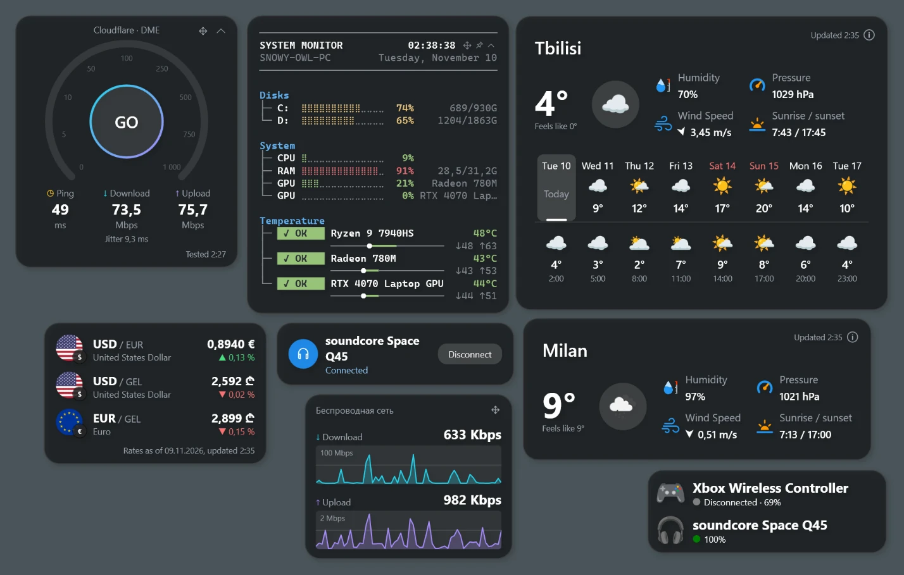
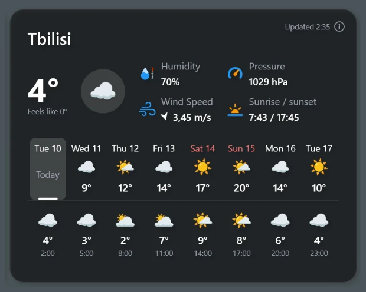
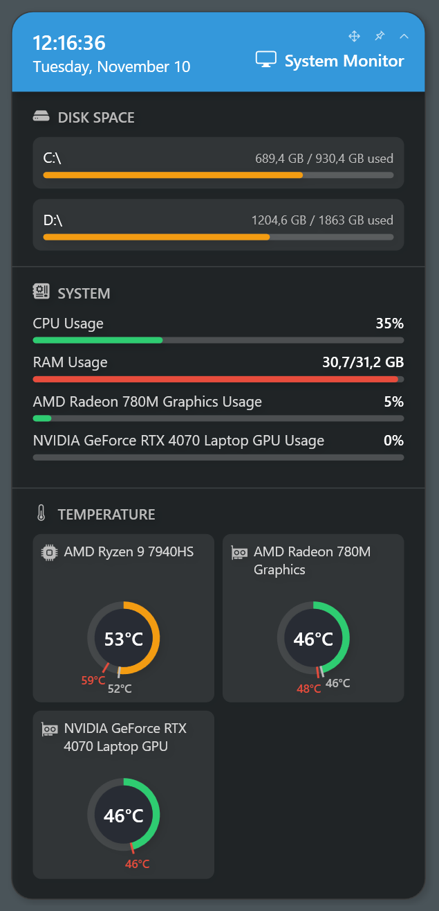
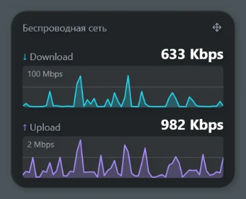
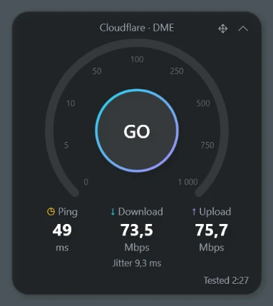
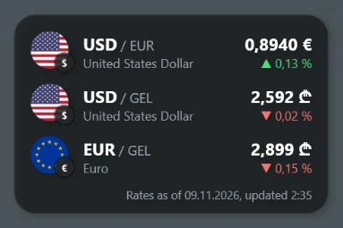
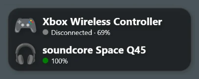
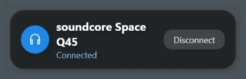
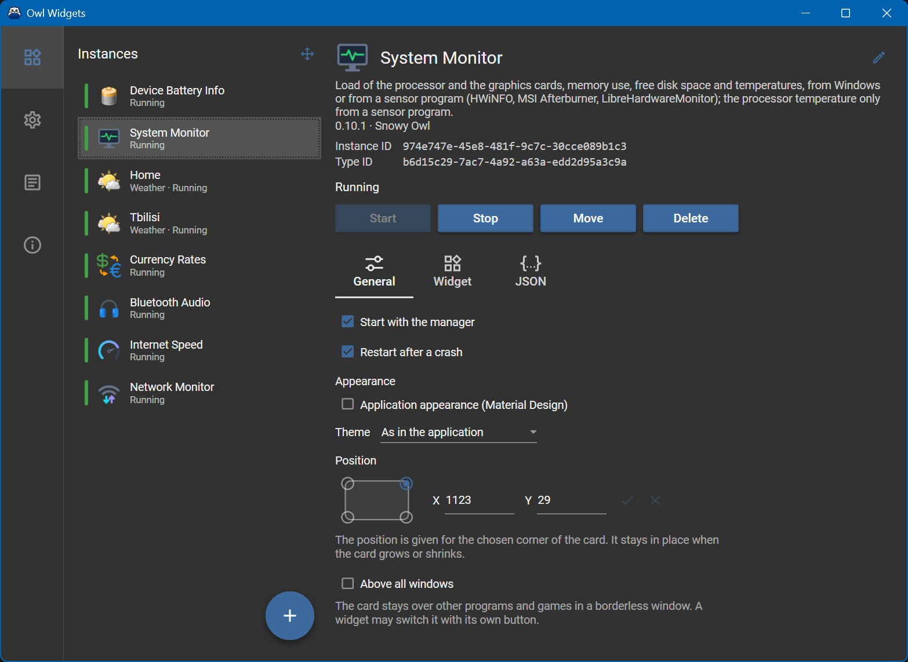

# Owl Widgets

**English** · [Русский](README.ru.md)

[](https://github.com/snowy-owll/OwlWidgets/releases/latest)


[](LICENSE)

Desktop widgets for Windows: weather, system monitor, network traffic, internet speed, exchange rates and Bluetooth devices. The cards live right on the desktop — above the icons and below regular windows — and stay clickable. One card can also be kept above all windows, games in a borderless window included.

<p align="center"></p>

## Features

- **Every card is a separate process.** A crashed widget does not take down the others or the manager; the manager can start it again.
- **Several copies of one widget**, each with its own settings: the weather of two cities, two network adapters, two currency lists.
- **Position by corner.** A card keeps the chosen corner in place when it grows or shrinks, so a card in the bottom right corner of the screen does not crawl off it.
- **Light and dark theme**, the Material Design look for the widgets that want it.
- **English and Russian** interface. Numbers, times and numeric dates follow the regional settings of Windows; names of days and months follow the interface language.
- **No administrator rights.** Everything, including the CPU and GPU readings, works as a regular user.
- **Portable.** Settings and logs are stored in the `Data` folder next to the program; autostart is a value in the registry of the current user.
- **Open for third-party widgets**: a widget is a folder with one or two DLLs, see [Creating widgets](Documentation/WidgetDevelopment.md).

## Widgets

| Widget | What it shows | Data source | Copies |
|---|---|---|---|
| **Weather** | Current weather and a forecast by day for a chosen place | [OpenWeatherMap](https://openweathermap.org/) (free API key) or [Open-Meteo](https://open-meteo.com/) (no key) | many |
| **System Monitor** | CPU and GPU load, memory, free disk space, CPU and GPU temperature; seven card styles | Windows and, optionally, HWiNFO, MSI Afterburner or LibreHardwareMonitor — [details](Documentation/SystemMonitor.md) | one |
| **Network Monitor** | Download and upload speed of a network adapter with graphs of the last minute | Windows adapter counters | many |
| **Internet Speed** | Ping, jitter, download and upload speed, on a button or on a schedule | [Cloudflare](https://speed.cloudflare.com/) or [M-Lab](https://www.measurementlab.net/) | many |
| **Currency Rates** | Exchange rates of up to 10 currency pairs and the change since the previous day | [Frankfurter](https://frankfurter.dev/) | many |
| **Device Battery Info** | Battery level of paired Bluetooth devices: headphones, gamepads, mice | Windows (Bluetooth device properties) | one |
| **Bluetooth Audio** | Whether paired Bluetooth headphones or a speaker are connected; connects and disconnects them with a click | Windows Core Audio | many |

### Weather



Temperature, feels like, humidity, wind, pressure, sunrise and sunset, and an optional forecast by day. The place is found by name on the settings screen. On the first start the widget is added by itself with the place guessed from the IP address of the computer. OpenWeatherMap needs a free API key; Open-Meteo works without one. The built-in weather icons can be replaced by your own set from a zip archive or a folder.

### System Monitor



CPU and memory load, the load and temperature of each video card, used space of the disks, minimum and maximum temperatures since the start. Windows gives everything except the CPU temperature; for that, the widget reads a sensor program running next to it. Styles: Classic, CLI report, htop, Prompt, btop, Board and ImHex. The card collapses into one line and can be kept above all windows, for example over a game. See [System Monitor: data sources](Documentation/SystemMonitor.md).

### Network Monitor



The current download and upload speed of the adapter Windows routes the internet through (or of a chosen one), in bits or bytes per second, with a graph of the last 60 seconds for each direction. With a VPN that carries all traffic, the VPN adapter is shown. Nothing is sent to the network.

### Internet Speed



A speedometer with ping, jitter, download and upload. The test runs on the Start button or every N minutes (30 or more). A test on a fast connection uses hundreds of megabytes, so mind metered connections. M-Lab publishes every test with the IP address in its open data.

### Currency Rates



Up to 10 currency pairs with flags, the latest rate and the change from the previous one. Rates come from the Frankfurter API without a key and are updated every hour by default.

### Device Battery Info



The battery level of the chosen paired Bluetooth devices (classic and Low Energy) that report it to Windows. A device that is turned off shows its last level. Each device gets an icon: a built-in one or your own picture.

### Bluetooth Audio



Connects and disconnects paired Bluetooth headphones or a speaker with one click, without going to the Windows settings, and shows whether they are connected now.

## Manager

<p align="center"></p>

The manager is the program itself: it sits in the notification area and starts the cards. Double-click the tray icon to open its window:

- **Widgets** — the copies of the widgets: add, start, stop, rename, delete. For each copy: the widget's own settings, the position and the corner it is counted from, "above all windows", start with the manager, restart after a crash, the application appearance, and the raw JSON of the settings. **Move widgets** turns on the move mode of all running cards at once.
- **Settings** — theme (as in Windows, light, dark), interface language, start with Windows, open the window on start, check for new versions on GitHub.
- **Log** — the log of the current session of the manager and of every widget copy.
- **About** — version, folders of the data and the logs, installed widgets, update check.

To move a card, choose **Move** in the manager (or the move button on the card if it has one), drag the card and confirm with the check mark.

## Requirements

- Windows 10 version 1803 or later, or Windows 11, 64-bit.
- [.NET 8 Desktop Runtime](https://dotnet.microsoft.com/download/dotnet/8.0) (x64). The program is framework-dependent and does not bring its own runtime.
- Internet access for Weather, Internet Speed, Currency Rates and the update check.
- Optional, for the CPU temperature in System Monitor: [HWiNFO](https://www.hwinfo.com/), [MSI Afterburner](https://www.msi.com/Landing/afterburner) or [LibreHardwareMonitor](https://github.com/LibreHardwareMonitor/LibreHardwareMonitor).

## Installation

1. Install the [.NET 8 Desktop Runtime](https://dotnet.microsoft.com/download/dotnet/8.0) if it is not installed yet.
2. Download the archive of the [latest release](https://github.com/snowy-owll/OwlWidgets/releases/latest).
3. Unpack it into a folder you can write to, for example `D:\Programs\OwlWidgets`. Not into `C:\Program Files`: the settings and logs are written next to the program, into `Data`.
4. Run `OwlWidgets.exe`. On the first start the manager window opens and a Weather card appears on the desktop.

To update, quit the program from the tray menu (**Exit**) and replace the files, keeping the `Data` folder. The manager tells about a new version in a notification; it does not update the files by itself.

To remove, turn off **Start with Windows** in the settings, quit the program and delete its folder.

## Building from source

You need the [.NET 8 SDK](https://dotnet.microsoft.com/download/dotnet/8.0). Visual Studio 2022 (workload ".NET desktop development"), Rider or VS Code are optional.

```bash
git clone https://github.com/snowy-owll/OwlWidgets.git
```

```bash
cd OwlWidgets
```

```bash
dotnet build OwlWidgets.sln -c Release
```

The program with all widgets is in `OwlWidgets/bin/Release/net8.0-windows/`: the build copies every widget into its `Widgets/{folder}` there. Run `OwlWidgets.exe` from that folder.

A folder ready to be copied elsewhere:

```bash
dotnet publish OwlWidgets/OwlWidgets.csproj -c Release -o publish
```

Tests:

```bash
dotnet test OwlWidgets.Tests
```

### Solution layout

| Project | Purpose |
|---|---|
| `OwlWidgets` | The manager: tray, list of widget copies, settings, log, desktop layer |
| `OwlWidgets.WidgetHost` | The host process of one card: window, move mode, channel to the manager |
| `OwlWidgets.Contracts` | Interfaces between widgets and the program: `IWidgetDescriptor`, `IWidgetRuntime`, commands |
| `OwlWidgets.Common` | `ViewModelBase`, `WallClock`, PnP device and Bluetooth helpers |
| `OwlWidgets.UI.Common` | Card styles, commands, number input, converters, shared controls |
| `OwlWidgets.Protocol` | The channel frame and log records between the manager and the hosts |
| `OwlWidgets.Widgets.{Name}` and `.Descriptor` | One widget: the card and its description with the settings screen |
| `OwlWidgets.Tests` | xUnit tests of the manager |

## Creating your own widget

A widget is a .NET 8 WPF library that implements two interfaces from `OwlWidgets.Contracts`, built into a folder under `Widgets`. The program finds it on start. See the [widget development guide](Documentation/WidgetDevelopment.md).

## Privacy

The program sends nothing about you anywhere by itself. Network requests are made only by the widgets that need them and only to their data sources: the weather provider, the geolocation by IP on the first start (ipinfo.io), Frankfurter, Cloudflare or M-Lab, and the GitHub API for the update check (which can be turned off in the settings).

## Third-party components and data

- [Material Design In XAML Toolkit](https://github.com/MaterialDesignInXAML/MaterialDesignInXamlToolkit) — MIT.
- [MahApps.Metro.IconPacks](https://github.com/MahApps/MahApps.Metro.IconPacks) (Bootstrap Icons) — MIT.
- Weather and device icons — [Noto Emoji](https://github.com/googlefonts/noto-emoji), Apache 2.0; widget icons from the [Tango Desktop Project](https://commons.wikimedia.org/wiki/Tango_icons) and Wikimedia Commons, public domain and CC0; flags — [country-flags](https://github.com/hampusborgos/country-flags), public domain.
- Weather data — OpenWeather (CC BY-SA 4.0) and Open-Meteo (CC BY 4.0); exchange rates — Frankfurter.

## License

The code is under the [MIT License](LICENSE). Third-party pictures keep their own licenses, which lie next to them (`LICENSE.txt` and `NOTICE.txt` in their folders).
