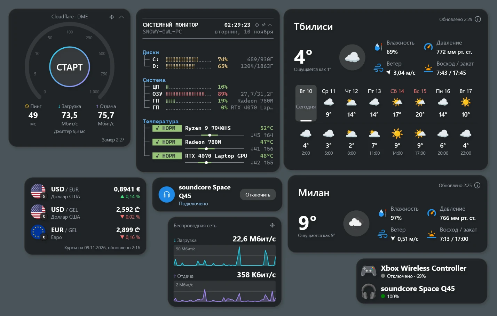
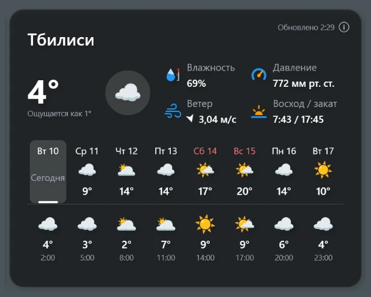
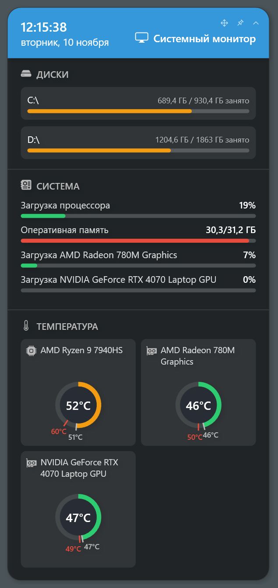
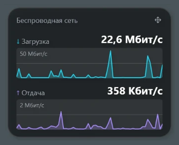
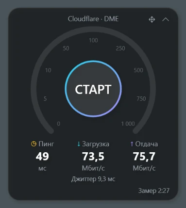
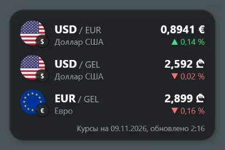
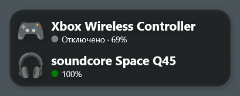
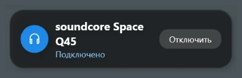
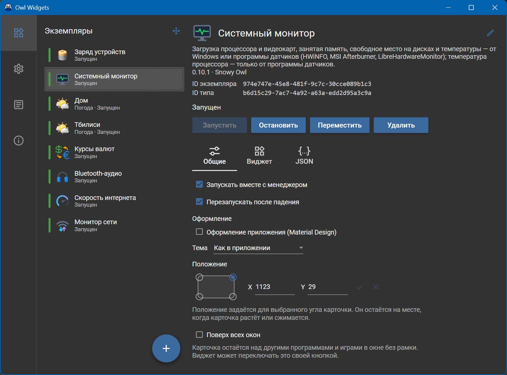

# Owl Widgets

[English](README.md) · **Русский**

[](https://github.com/snowy-owll/OwlWidgets/releases/latest)


[](LICENSE)

Виджеты рабочего стола для Windows: погода, монитор системы, сетевой трафик, скорость интернета, курсы валют и Bluetooth-устройства. Карточки живут прямо на рабочем столе — над значками и под обычными окнами — и при этом откликаются на мышь. Любую карточку можно держать и поверх всех окон, в том числе поверх игры в окне без рамки.

<p align="center"></p>

## Возможности

- **Каждая карточка — отдельный процесс.** Упавший виджет не роняет остальные и менеджер; менеджер может запустить его снова.
- **Несколько копий одного виджета**, у каждой свои настройки: погода двух городов, два сетевых адаптера, два списка валют.
- **Положение по углу.** Карточка держит выбранный угол на месте, когда растёт или сжимается, поэтому карточка в правом нижнем углу экрана с него не уползает.
- **Светлая и тёмная тема**, оформление Material Design для виджетов, которым оно нужно.
- **Английский и русский** интерфейс. Числа, время и даты цифрами — по региональным настройкам Windows, названия дней недели и месяцев — на языке интерфейса.
- **Без прав администратора.** Всё, включая показания процессора и видеокарт, работает от обычного пользователя.
- **Переносимость.** Настройки и журналы лежат в папке `Data` рядом с программой; автозапуск — значение в реестре текущего пользователя.
- **Открыто для сторонних виджетов**: виджет — это папка с одной или двумя DLL, см. [Создание виджетов](Documentation/WidgetDevelopment.ru.md).

## Виджеты

| Виджет | Что показывает | Источник данных | Копий |
|---|---|---|---|
| **Погода** | Текущая погода и прогноз по дням для выбранного места | [OpenWeatherMap](https://openweathermap.org/) (бесплатный ключ API) или [Open-Meteo](https://open-meteo.com/) (без ключа) | много |
| **Системный монитор** (System Monitor) | Загрузка процессора и видеокарт, память, место на дисках, температура процессора и видеокарт; семь стилей карточки | Windows и, по желанию, HWiNFO, MSI Afterburner или LibreHardwareMonitor — [подробнее](Documentation/SystemMonitor.ru.md) | одна |
| **Монитор сети** (Network Monitor) | Скорость загрузки и отдачи сетевого адаптера с графиками за последнюю минуту | Счётчики адаптера Windows | много |
| **Скорость интернета** (Internet Speed) | Пинг, джиттер, скорость загрузки и отдачи — по кнопке или по расписанию | [Cloudflare](https://speed.cloudflare.com/) или [M-Lab](https://www.measurementlab.net/) | много |
| **Курсы валют** (Currency Rates) | Курсы до 10 валютных пар и изменение к предыдущему дню | [Frankfurter](https://frankfurter.dev/) | много |
| **Заряд устройств** (Device Battery Info) | Уровень заряда спаренных Bluetooth-устройств: наушников, геймпадов, мышей | Windows (свойства Bluetooth-устройств) | одна |
| **Bluetooth-аудио** (Bluetooth Audio) | Подключены ли спаренные Bluetooth-наушники или колонка; подключает и отключает их одним щелчком | Windows Core Audio | много |

### Погода



Температура, ощущается как, влажность, ветер, давление, восход и закат и, по желанию, прогноз по дням. Место ищется по названию на экране настроек. На первом запуске виджет добавляется сам, с местом, определённым по IP-адресу компьютера. OpenWeatherMap нужен бесплатный ключ API, Open-Meteo работает без него. Встроенные значки погоды можно заменить своим набором из zip-архива или папки.

### Системный монитор



Загрузка процессора и памяти, загрузка и температура каждой видеокарты, занятое место на дисках, минимум и максимум температур со старта. Всё, кроме температуры процессора, даёт Windows; за ней виджет обращается к программе датчиков, запущенной рядом. Стили: классический, CLI-отчёт, htop, промпт, btop, табло и ImHex. Карточка сворачивается в одну строку и может стоять поверх всех окон, например поверх игры. Подробнее — [Системный монитор: источники данных](Documentation/SystemMonitor.ru.md).

### Монитор сети



Текущая скорость загрузки и отдачи адаптера, через который Windows ходит в интернет (или выбранного), в битах или байтах в секунду, с графиком за последние 60 секунд для каждого направления. При VPN, через который идёт весь трафик, показывается адаптер VPN. В сеть ничего не отправляется.

### Скорость интернета



Спидометр с пингом, джиттером, загрузкой и отдачей. Замер идёт по кнопке «Старт» или раз в N минут (не меньше 30). Замер на быстром соединении тратит сотни мегабайт — учитывайте это на лимитном подключении. M-Lab публикует каждый замер вместе с IP-адресом в своих открытых данных.

### Курсы валют



До 10 валютных пар с флагами, последний курс и изменение к предыдущему. Курсы — из Frankfurter API без ключа, по умолчанию обновляются раз в час.

### Заряд устройств



Уровень заряда выбранных спаренных Bluetooth-устройств (классических и Low Energy), которые сообщают его Windows. У выключенного устройства виден последний уровень. Каждому устройству — свой значок: встроенный или своя картинка.

### Bluetooth-аудио



Подключает и отключает спаренные Bluetooth-наушники или колонку одним щелчком, без похода в параметры Windows, и показывает, подключены ли они сейчас.

## Менеджер

<p align="center"></p>

Менеджер — это сама программа: он живёт в области уведомлений и запускает карточки. Двойной щелчок по значку в трее открывает его окно:

- **Виджеты** — копии виджетов: добавить, запустить, остановить, переименовать, удалить. У каждой копии: собственные настройки виджета, положение и угол, от которого оно отсчитывается, «поверх всех окон», запуск вместе с менеджером, перезапуск после падения, оформление приложения и JSON настроек как есть. **Переместить виджеты** включает режим перемещения сразу у всех запущенных карточек.
- **Настройки** — тема (как в Windows, светлая, тёмная), язык интерфейса, запуск вместе с Windows, открывать окно при запуске, проверка новых версий на GitHub.
- **Журнал** — журнал текущего сеанса менеджера и каждой копии виджета.
- **О программе** — версия, папки данных и журналов, установленные виджеты, проверка обновлений.

Чтобы передвинуть карточку, выберите **Переместить** в менеджере (или кнопку перемещения на самой карточке, если она есть), перетащите карточку и подтвердите галочкой.

## Требования

- Windows 10 версии 1803 и новее или Windows 11, 64-разрядная.
- [.NET 8 Desktop Runtime](https://dotnet.microsoft.com/download/dotnet/8.0) (x64). Программа зависит от установленного .NET и своего рантайма не везёт.
- Доступ в интернет — для Погоды, Скорости интернета, Курсов валют и проверки обновлений.
- По желанию, для температуры процессора в Системном мониторе: [HWiNFO](https://www.hwinfo.com/), [MSI Afterburner](https://www.msi.com/Landing/afterburner) или [LibreHardwareMonitor](https://github.com/LibreHardwareMonitor/LibreHardwareMonitor).

## Установка

1. Установите [.NET 8 Desktop Runtime](https://dotnet.microsoft.com/download/dotnet/8.0), если его ещё нет.
2. Скачайте архив [последнего выпуска](https://github.com/snowy-owll/OwlWidgets/releases/latest).
3. Распакуйте его в папку, куда у вас есть право записи, например `D:\Programs\OwlWidgets`. Не в `C:\Program Files`: настройки и журналы пишутся рядом с программой, в `Data`.
4. Запустите `OwlWidgets.exe`. На первом запуске откроется окно менеджера, а на рабочем столе появится карточка погоды.

Чтобы обновить, закройте программу из меню трея (**Выход**) и замените файлы, оставив папку `Data`. О новой версии менеджер сообщает уведомлением; сам файлы он не обновляет.

Чтобы удалить, выключите **Запускать вместе с Windows** в настройках, закройте программу и удалите её папку.

## Сборка из исходников

Нужен [.NET 8 SDK](https://dotnet.microsoft.com/download/dotnet/8.0). Visual Studio 2022 (нагрузка «Разработка классических приложений .NET»), Rider или VS Code — по желанию.

```bash
git clone https://github.com/snowy-owll/OwlWidgets.git
```

```bash
cd OwlWidgets
```

```bash
dotnet build OwlWidgets.sln -c Release
```

Программа со всеми виджетами — в `OwlWidgets/bin/Release/net8.0-windows/`: сборка копирует каждый виджет в его папку `Widgets/{папка}` там же. Запускайте `OwlWidgets.exe` из этой папки.

Папка, готовая к переносу в другое место:

```bash
dotnet publish OwlWidgets/OwlWidgets.csproj -c Release -o publish
```

Тесты:

```bash
dotnet test OwlWidgets.Tests
```

### Состав решения

| Проект | Назначение |
|---|---|
| `OwlWidgets` | Менеджер: трей, список копий виджетов, настройки, журнал, слой рабочего стола |
| `OwlWidgets.WidgetHost` | Процесс-обёртка одной карточки: окно, режим перемещения, канал с менеджером |
| `OwlWidgets.Contracts` | Интерфейсы между виджетами и программой: `IWidgetDescriptor`, `IWidgetRuntime`, команды |
| `OwlWidgets.Common` | `ViewModelBase`, `WallClock`, работа с устройствами PnP и Bluetooth |
| `OwlWidgets.UI.Common` | Стили карточки, команды, ввод чисел, конвертеры, общие элементы |
| `OwlWidgets.Protocol` | Кадр канала и записи журнала между менеджером и обёртками |
| `OwlWidgets.Widgets.{Name}` и `.Descriptor` | Один виджет: карточка и его описание с экраном настроек |
| `OwlWidgets.Tests` | Тесты менеджера на xUnit |

## Свой виджет

Виджет — это библиотека WPF на .NET 8, которая реализует два интерфейса из `OwlWidgets.Contracts` и собирается в папку внутри `Widgets`. Программа находит его при запуске. См. [руководство по созданию виджетов](Documentation/WidgetDevelopment.ru.md).

## Конфиденциальность

Сама программа никуда ничего о вас не отправляет. Запросы в сеть делают только виджеты, которым они нужны, и только к своим источникам данных: провайдеру погоды, определению места по IP на первом запуске (ipinfo.io), Frankfurter, Cloudflare или M-Lab, а также к API GitHub для проверки обновлений (её можно выключить в настройках).

## Сторонние компоненты и данные

- [Material Design In XAML Toolkit](https://github.com/MaterialDesignInXAML/MaterialDesignInXamlToolkit) — MIT.
- [MahApps.Metro.IconPacks](https://github.com/MahApps/MahApps.Metro.IconPacks) (Bootstrap Icons) — MIT.
- Значки погоды и устройств — [Noto Emoji](https://github.com/googlefonts/noto-emoji), Apache 2.0; значки виджетов — из [Tango Desktop Project](https://commons.wikimedia.org/wiki/Tango_icons) и Wikimedia Commons, общественное достояние и CC0; флаги — [country-flags](https://github.com/hampusborgos/country-flags), общественное достояние.
- Данные погоды — OpenWeather (CC BY-SA 4.0) и Open-Meteo (CC BY 4.0); курсы валют — Frankfurter.

## Лицензия

Код распространяется по [лицензии MIT](LICENSE). Сторонние картинки остаются под своими лицензиями, тексты которых лежат рядом с ними (`LICENSE.txt` и `NOTICE.txt` в их папках).
